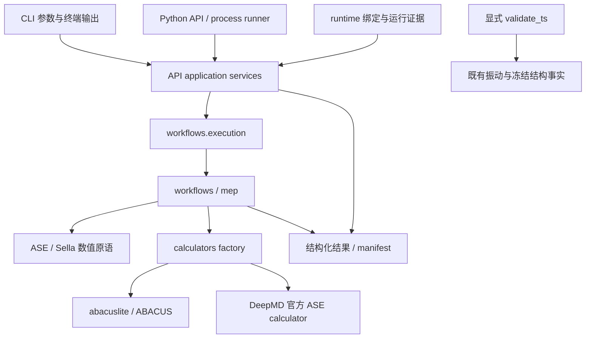

# 文档系统架构与结构图

**版本**: 2026-10-15
**日期**: 2026-10-15
**状态**: 维护
**责任人**: ATST-Tools maintainers

本文档说明 ATST-Tools 文档树的职责边界。它服务于三类读者：用户、开发者和项目管理者。
文档围绕 ASE 调用 ABACUS/DP 的过渡态计算组织，命令行与 Agent Python Interface
共同消费同一科学能力；两种入口的使用与结果交接均属于长期用户文档。

## 1. 目标读者

- **用户**：安装 ATST-Tools，选择示例，经 CLI/YAML 或 Agent Python API/process runner
  运行 ABACUS/DP 工作流；理解结构、阶段事实、manifest 与科学验证结果的交接。
- **开发者**：扩展 workflow、calculator backend、YAML schema、CLI、examples、tests 和文档。
- **项目管理者**：判断功能支持状态、验证证据、发布范围、文档健康度和下一步优先级。

## 2. 目录职责

```text
docs/
├── index.md                            # 三类读者的文档入口
├── user/                               # 用户指南、CLI/YAML 参考、backend 使用边界
├── developer/                          # 开发规范、文档治理、YAML 治理、发布和交接
├── reports/                            # 当前仍有证据价值的状态、验证、审查报告
├── releases/                           # 版本级发布说明
├── skills/                             # 可复用操作说明和 agent/developer quick reference
├── superpowers/                        # 设计 spec 与开发计划
│   ├── specs/                          # brainstorming 设计、审查结论和决策记录
│   └── plans/                          # 仍计划执行的开发计划（须在治理账本登记）
└── archive/                            # 历史归档；pending_delete/ 为待删除复核区
```

| 路径 | 职责 | 不应承载 |
| :--- | :--- | :--- |
| `docs/index.md` | 文档总入口和三条阅读路径 | 完整历史报告清单、临时计划 |
| `docs/user/` | 用户手册、CLI/YAML 参考、ABACUS/DP 使用说明 | 阶段性开发计划、失败复盘 |
| `docs/developer/` | 开发规范、治理规则、维护 checklist | 阶段验证报告 |
| `docs/superpowers/specs/` | 设计 spec、审查结论与决策记录 | 已执行完毕且不再影响当前设计的材料 |
| `docs/superpowers/plans/` | 仍要执行的计划；新增计划须同步登记治理账本 | 已完成计划、历史设想 |
| `docs/reports/` | 当前状态页、验证证据、仍有效的工程审查 | 已被最终报告取代的中间记录 |
| `docs/releases/` | release notes | 日常开发报告 |
| `docs/skills/` | 可复用操作手册 | 项目状态报告 |
| `docs/archive/` | 有审计价值的历史材料 | 活跃入口依赖的文档 |
| `docs/archive/pending_delete/` | 已过时但待最终删除确认的文件 | 仍有当前证据价值的文件 |

## 3. 生命周期类型

新文档必须在文首或首段能判断生命周期类型：

| 类型 | 含义 | 典型位置 |
| :--- | :--- | :--- |
| `guide` | 长期维护的用户或开发者指南 | `docs/user/`, `docs/developer/` |
| `reference` | 长期查表材料，例如 CLI/YAML 字段 | `docs/user/` |
| `status` | 当前状态入口 | `docs/reports/` |
| `validation` | 运行、单测、环境或科学验证证据 | `docs/reports/` |
| `review` | 边界分析、迁移审查、方案权衡 | `docs/reports/` |
| `spec` | 设计来源、需求决策与审查结论 | `docs/superpowers/specs/` |
| `plan` | 尚待执行的计划（须在治理账本登记） | `docs/superpowers/plans/` |
| `release` | 版本级发布记录 | `docs/releases/` |
| `archive` | 不再指导当前工作的历史材料 | `docs/archive/` |

## 4. 导航原则

- `README.md` 和 `docs/index.md` 只链接活跃入口，不列完整历史报告清单。
- 完整 reports 账本放在
  [DOCUMENTATION_STATUS_REPORT.md](../reports/DOCUMENTATION_STATUS_REPORT.md)。
- 用户路径不得要求先阅读 `docs/reports/` 才能运行示例。
- 开发者路径从 [HANDOVER.md](HANDOVER.md) 和
  [YAML_INPUT_GOVERNANCE.md](YAML_INPUT_GOVERNANCE.md) 开始。
- 项目管理路径从
  [FEATURE_STATUS_MATRIX.md](../reports/FEATURE_STATUS_MATRIX.md) 和
  [DOCUMENTATION_STATUS_REPORT.md](../reports/DOCUMENTATION_STATUS_REPORT.md)
  开始。
- 活跃入口不得链接 `docs/archive/` 或 `docs/archive/pending_delete/`，治理账本和
  pending-delete 说明除外。

## 5. 执行入口与共享实现

CLI/YAML 与 Agent Python API 共同调用科学 workflow。内部执行实现位于
`atst_tools.workflows.execution`；`api.services` 先确定调用方的 MPI world，再调度
其中的 workflow helper；`scripts.main` 保留 CLI 参数解析、模板、日志与终端错误展示。
独立 validation API 只读取已保存的振动和冻结结构事实，不会由计算 workflow 自动启动。

### 5.1 代码模块与依赖方向



| 模块 | 核心职责与扩展入口 |
| --- | --- |
| `scripts/cli.py`、`cli_impl.py`、`main.py` | 轻量 bootstrap、子命令、参数、模板与终端适配；不作为 API 的执行依赖。 |
| `api/services.py`、`models.py`、`runner.py` | 配置归一化、错误与 MPI 同步、root 产物及 Python/JSON 交接；公共导出由 `api/__init__.py` 管理。 |
| `workflows/execution.py`、`workflows/`、`mep/` | 分派及科学阶段执行；优化器报告真实收敛事实，复合 workflow 聚合阶段并拥有顶层 manifest。 |
| `calculators/`、`external/` | calculator 装配和后端委派；ABACUS/DP 数值计算仍属上游，vendored 补丁按快照账本治理。 |
| `utils/config_schema.py`、`config.py` | YAML 类型、默认值及归一化；`config_docs.py` 生成字段表。 |
| `utils/geometry.py`、`artifacts.py`、`convergence.py` | 共享几何准备、产物持久化和优化终止事实。 |
| `runtime/`、`bench/` | 设备/线程绑定、隔离与测量；在已有资源内运行，不承担集群资源申请。 |

新 workflow 的常规修改路径是 schema → workflow/MEP → execution dispatch → 用户
模板/参考 → 示例及 owning tests。稳定集成入口是 `atst_tools.api`；内部模块不是
稳定外部 API。CLI 与 API 的产物补齐、错误包装和 preflight 路径历史差异见
[API 参考](../user/PYTHON_API_REFERENCE.md)，不能因共享执行层而抹平。

### 5.2 文档事实来源

| 事实 | 维护源 | 阅读入口 |
| --- | --- | --- |
| 包版本、依赖与安装 extra | `pyproject.toml` | README、安装指南；发布证据引用对应 release notes。 |
| YAML 类型与默认值 | `config_schema.py` | 生成参数表；手写 CONFIG_REFERENCE 解释组合语义。 |
| CLI 参数与公共 API | 对应 parser、稳定导出和行为测试 | CLI_REFERENCE、PYTHON_API_REFERENCE。 |
| 当前支持及未发布边界 | FEATURE_STATUS_MATRIX | 用户导航链接，不复制完整开发历史。 |
| 实施证据与设计裁决 | 活跃 spec、报告及原始日志 | 治理账本登记；完成计划归档，结论吸收到长期入口。 |

图与模块表描述当前开发树；具体未发布行为必须在用户入口标明，不能仅凭包版本号
推断其已发行。每次修改应同步受影响的长期入口，避免让新人从历史计划拼接现状。

## 6. 状态入口

- 主入口：[docs/index.md](../index.md)
- 中文用户指南：[USER_GUIDE_CN.md](../user/USER_GUIDE_CN.md)
- CLI 参考：[CLI_REFERENCE.md](../user/CLI_REFERENCE.md)
- YAML 语义参考：[CONFIG_REFERENCE.md](../user/CONFIG_REFERENCE.md)
- YAML 参数总表：[YAML_INPUT_VARIABLES.md](../user/YAML_INPUT_VARIABLES.md)
- 功能矩阵：[FEATURE_STATUS_MATRIX.md](../reports/FEATURE_STATUS_MATRIX.md)
- 文档治理账本：[DOCUMENTATION_STATUS_REPORT.md](../reports/DOCUMENTATION_STATUS_REPORT.md)
- 发布说明：[RELEASE_NOTES_2.2.8.md](../releases/RELEASE_NOTES_2.2.8.md)，记录当前
  已发布 2.2.8 的 tag/CI/PyPI 与 clean-install 证据；后续未发布开发不改写该记录。
  此前已发布的 [2.2.5 release notes](../releases/RELEASE_NOTES_2.2.5.md) 与
  [2.2.4 release notes](../releases/RELEASE_NOTES_2.2.4.md) 保留为历史发布记录。
