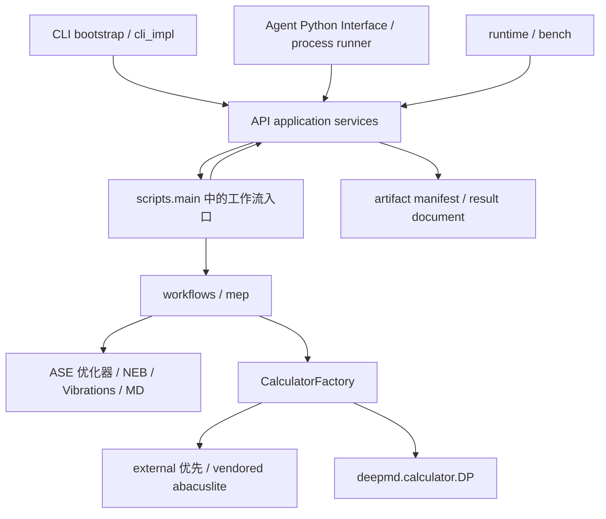
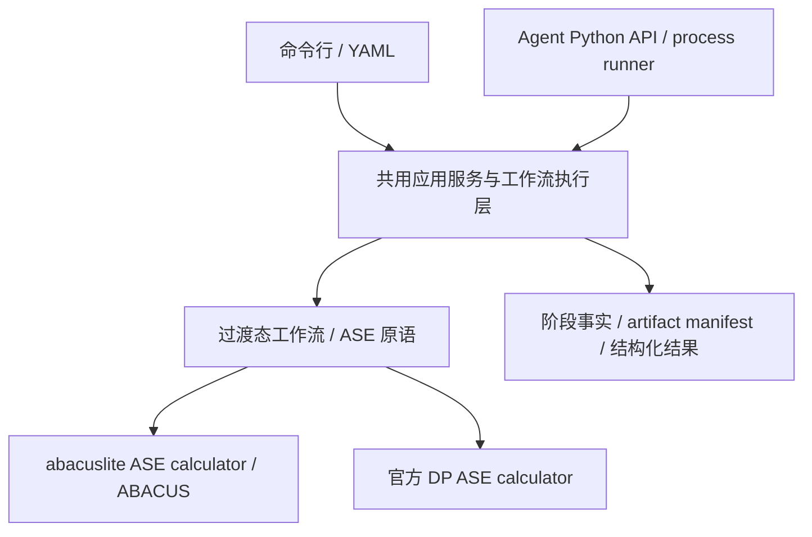

# ATST-Tools 架构、实现、分发与开源协作审查

**版本**: 2026-10-13（代码基线 2.2.8 开发树）
**日期**: 2026-10-13
**状态**: 本地整改验收完成，未发布（原始发现保留；见 §9）
**责任人**: ATST-Tools maintainers

> §1–§8 保留对应日期的发现与局部实施证据；2026-10-15 的整改状态见 §9。

## 1. 结论与范围

**架构总体符合仓库目的；实现存在已复现的科学输入与运行边界错误；分发模式合理，但当前构建产物的第三方许可声明不完整。开源协作基础已经具备，贡献者交接仍需补齐。不能对“实现和分发均满足要求”给出无保留结论。**

审查基线为 `45d8c78de8a605c127cd4c36742d0c9525a0a6b6`，审查开始时工作树干净，
`pyproject.toml` 版本为 `2.2.8`。首次审查只新增报告、证据摘要和状态登记；后续局部
实施见 §7，面向 CLI/Python Interface 的复核与优化优先级见 §8。未创建版本标签或
执行发布。构建对象是该 HEAD 的 `git archive` 干净导出，不能等同于
已经发布的 PyPI 产物；当前 HEAD 也不是本地 `v2.2.8` 标签所指的提交。

覆盖 CLI/YAML、Python API、calculator、MEP/workflows、runtime/bench、测试、
vendored 来源、PEP 517 构建、wheel/sdist 内容、CI、发布与开发者文档。采用静态调用链
检查、完整默认测试、额外真实 MPI launcher 回归、干净构建和边界输入复现。
不是逐函数形式化证明，也没有重新执行 ABACUS/DP 的 GPU 科学计算。

严重度：P1 为需优先解决的科学正确性或分发缺陷；P2 为有明确影响的运行、架构或协作缺口；
P3 为后续维护改善。等级表达审查建议，不新增仓库审批或发布契约。

| 维度 | 判断 | 依据及限制 |
| --- | --- | --- |
| 仓库定位 | 符合 | CLI/YAML 与 Agent Python Interface 共同消费 ASE 过渡态工作流；ABACUS 经 abacuslite，DP 经官方 ASE calculator。 |
| 代码架构 | 基本符合 | calculator、工作流、配置、产物、运行时已有边界；API 对 CLI 的反向依赖尚未收敛。 |
| 实现正确性 | 有条件符合 | 主测试及 MPI 回归通过；发现 PBC 插值静默错误和 Relax 回退分支错误。 |
| 分发模式 | 合理 | GitHub 规范源、Gitee 手动只读镜像、PyPI 包分发；重型后端按 extra 分层。 |
| 分发产物 | 需整改 | 可构建并安装，但 PyDMF MIT 版权及许可文本未随代码进入 wheel/sdist。 |
| 开源协作 | 基础具备，交接不足 | 有公开 PR CI、固定上游基线与文档治理；新贡献者安装/测试路径不完整。 |

## 2. 架构与项目目的的对应关系



图中 API 与 `scripts.main` 的双向依赖是现状，见 F4；runtime/bench 负责设备、进程与
测量，不承担科学算法或集群资源申请。

- `calculators/abacuslite_backend.py:16` 先导入独立 abacuslite，只有模块本身缺失时才
  回退 vendored；不会吞掉后端内部依赖缺失。`factory.py:137` 封装 ABACUS profile、
  参数和命令，`dp.py` 保留官方 DeepMD calculator 入口，符合 backend wrapper 定位。
- `config_schema.py:37` 对工作流及顶层配置禁用未知字段，ABACUS 参数区允许透传；
  `normalize_config` 与生成 YAML 文档复用 schema。CLI 与 API 共享归一化契约。
- Relax、Vibration、Dimer、Sella、IRC、MD 大量复用 ASE/Sella；CCQN、DMF 属于有
  明确科学方法来源或实验边界的扩展，不能仅因并非 ASE 内置算法而判定背离目标。
- `mep/neb.py:34` 记录 ASE 3.28.0 与 real-force 回移 SHA；AutoNEB 同样注明复用版本。
  局部复制/覆盖有实际目的，且有回归测试。它带来上游升级责任，但不是重写整个 ASE。
- API result、artifact manifest 和 tri-state convergence 将“流程执行完成”与
  “科学收敛”区分；DMF 与 constant-potential 候选边界有显式文档，这是应保留的设计。
- 第一方有 68 个 Python 文件、约 2.25 万行；较大模块包括 `api/services.py`（1037 行）、
  `scripts/main.py`（1103 行）、`config_schema.py`（1301 行）和
  `calculators/constant_potential.py`（1679 行）。体量仅用于识别维护触点，不作为缺陷判据。

## 3. 优先整改问题

### F1 · P1 · 插值错误处理非周期方向和斜胞 MIC

**位置**：`src/atst_tools/utils/idpp.py:99`，尤其 `:101–104`。

`robust_interpolate` 对所有分数坐标差统一执行 `delta - round(delta)`，没有应用
`Atoms.pbc`。在非周期方向上把真实位移折返；对于斜胞，分数坐标逐分量取整也不保证得到
最短 Cartesian 位移。函数名和 docstring 声称 PBC robust，但实现不支持这些合法输入。

已复现：

| 输入 | 实际中点 | 应有中点 |
| --- | --- | --- |
| 10 Å 正交胞，`pbc=[True,True,False]`，H 的 z 从 1 到 8 | z = −0.5 Å | z = 4.5 Å |
| 默认零胞、`pbc=False`，H 的 x 从 0 到 1（独立 reviewer 复现） | x = 0 Å | x = 0.5 Å |
| 斜胞 `[[1,0,0],[0.9,0.1,0],[0,0,5]]`，周期 x/y；位移 `[0.931,0.049,0]` | `[0.4655,0.0245,0]` | ASE MIC 对应 `[0.0155,-0.0255,0]` |

斜胞例中逐分量折返得到位移长 0.93229 Å，ASE `find_mic` 为 0.05968 Å。
这会生成错误初始路径，而不一定报错。公共 `interpolate_path(method="linear")`、
`Fast_IDPPSolver.from_endpoints`、NEB input preparation 及
`workflows/d2s.py:298` 的 rough NEB 都可达此路径。

同一修复范围还应检查 `align_atom_indices` 的 `idpp.py:72–75`：它同样对全部坐标
使用 fractional rounding，部分周期/斜胞的距离矩阵可能错误；本次没有另行声称其所有
原子映射都会错误。`Fast_IDPPSolver` 的有限晶格平移扫描也应审查 PBC mask 的一致性。

2026-10-13 设计澄清中又复现：部分周期的原子对齐把正确 z 顺序 [6,9] 变成 [9,6]；
非周期但有有限 cell 的 IDPP 对已经满足目标距离的静态路径产生非零 objective 和力。
这两项已加入证据摘要，纳入同一几何修复范围。有效数字与固定晶胞边界、历史方法兼容
及执行/交付责任见[后续设计](../superpowers/specs/2026-10-13-scientific-contracts-and-delivery-design.md)；
设计记录不代表本报告问题已修复。

**建议**：复用 ASE `find_mic(delta_cart, cell, pbc)` 或相应 ASE 几何原语，保持端点、
约束和不擅自移动原子等既有契约；补非周期、部分周期、斜胞、跨胞位移回归。
现有 `idpp.py` 行覆盖达 98%，但未保护这些科学输入，不能用覆盖率代替边界验证。

最小复现（先确保导入当前 checkout）：

```python
from ase import Atoms
from atst_tools.utils.idpp import interpolate_path

start = Atoms("H", positions=[[0, 0, 1]], cell=[10, 10, 10],
              pbc=[True, True, False])
end = start.copy()
end.positions[0, 2] = 8
path = interpolate_path(start, end, 1, method="linear")
print(path[1].positions)  # Current result: z=-0.5; expected: z=4.5.
```

### F2 · P1 · wheel 与 sdist 漏掉 PyDMF 必须保留的许可声明

**位置**：[pyproject.toml](../../pyproject.toml) 的 build/project 配置、
[PyDMF LICENSE](../../src/atst_tools/external/pydmf/LICENSE) 和
[UPSTREAM.md](../../src/atst_tools/external/pydmf/UPSTREAM.md)。

在 `git archive HEAD` 的干净导出上运行 PEP 517 build，生成的 wheel 有 110 个成员，
sdist 有 137 个成员。两者都包含 `external/pydmf/dmf/*.py`，但都不含其 MIT LICENSE，
亦无 Shin-ichi Koda 的对应许可文件。wheel 仅带项目根 `LICENSE` 与 `COPYING`。
该 LICENSE 要求随代码保留版权和许可声明；根 LGPL 文本不包含这份 MIT 声明。
这与 [MIT 许可文本](https://opensource.org/license/mit) 的保留条件不一致。

`python -m build`、严格 Twine 和 clean-wheel API gate 均通过，说明这些现有检查
不检查第三方 notice 完整性。问题不是构建失败，而是成功构建的内容不完整。

**建议**：显式配置 license-files/package-data，分别检查 wheel/sdist 中许可内容，
并准确描述组合分发的许可证范围；不要只验证 checkout 中 LICENSE 存在。
非 Python 文件进入产物需要明确规则，见
[setuptools data files](https://setuptools.pypa.io/en/latest/userguide/datafiles.html)。

ABACUS `ABACUSLITE_SNAPSHOT.md`/`PATCHES.md` 与 PyDMF `UPSTREAM.md` 也未进入产物，
这是另外的维护溯源缺口。abacuslite README 的许可位置仍为占位符；不过固定基线
`70f7ed69b5677c447afdc78e05240e93da660e66` 的
[上游根许可证](https://raw.githubusercontent.com/deepmodeling/abacus-develop/70f7ed69b5677c447afdc78e05240e93da660e66/LICENSE)
是 LGPLv3，不能据占位符断言“无许可”或“GPL 冲突”。PyDMF 来源还应补公开上游 URL，
不能仅写本地 `temp_repos/dmf`。来源说明与必须随附的 MIT notice 应分别验收。

本次未下载已发布 PyPI wheel，因此 F2 直接结论限定于当前 HEAD 的新构建产物；
后续需核对已有发布包是否存在相同遗漏。

### F3 · P2 · Relax 的 init.traj 回退分支未读取 atoms

**位置**：`src/atst_tools/workflows/relax.py:95–106`，随后 `:122` 使用 `atoms`。

配置的 `init_structure` 不存在、当前目录存在 `init.traj` 时，分支只改变路径，
却没有执行读取。随后给未赋值的 `atoms.calc` 赋值。以 EMT 替身代替 ABACUS calculator
构建，通过公共 `run_workflow` 复现 `WorkflowExecutionError`，其 cause 为
`UnboundLocalError: local variable 'atoms' referenced before assignment`。
替身仅隔离外部 executable，不替换 Relax 的路径判断、读取或 API 错误转换。

正常输入路径存在、或使用 restart 的分支不受此问题影响。
**建议**：先确定最终输入路径，再统一读取；补回退成功、无任何可读输入以及 restart 回归。

### F4 · P2 · API 执行层反向依赖 CLI 模块

**位置**：`api/services.py:169` → `scripts/main.py`；后者 `:17–18` 又导入 API/services。
preflight 的 `services.py:109` 也从 CLI 模块导入实际位于 `utils.abacus_io` 的 helper。

CLI 文件同时承担 NEB/Dimer/Sella/CCQN 工作流执行、模板与 argparse；新增工作流需要
维护 schema/type map、API dispatch、CLI/template 等多处。延迟导入避免了当前初始化死环，
且这些文件都在 wheel 中，故不是当前 API 无法安装或运行的证明。
但 CLI 修改会影响 API 执行，工作流 dispatch 导入所有入口也增加隔离和独立测试成本。

**建议**：把执行入口与 dispatch 下沉到应用/工作流层，CLI/API 都调用这一层；
preflight 直接引用实际 helper。用有限类型到 runner 的映射减少重复登记，不必预先建设
插件系统。公共 API、CLI、YAML 与产物契约按行为等价迁移验证。

### F5 · P2 · 新贡献者缺少完整的开发入口

**位置**：`README.md:109–111`、`docs/developer/HANDOVER.md`、
`.github/workflows/tests.yml:30–37`。

公开 PR CI 已经使用普通 `pip install -e ".[test]"` 和 pytest，证明基本开发不需要 SAI。
但 README 导向 HANDOVER 后，长期开发入口没有给出从新环境到 editable 安装、测试和
格式检查的完整步骤，主要命令默认已有 `atst-dev`。没有说明 fork/branch/PR 基本路径、
哪些测试默认跳过、何时需要模型/MPI/GPU，以及如何确认实际 import 来自本 checkout。

本次现有 `atst-dev` 恰好 editable 指向另一份 checkout，未经路径核查的首轮测试导入了
另一份源码。本次发现后作废首轮证据，绑定当前源码重新执行。CI 已先执行 editable
安装，不能把本地环境污染等同于 CI 缺陷；它说明贡献者入口应提供 import 身份检查。

**建议**：在单一 CONTRIBUTING 或 HANDOVER 入门节给出新建 venv/conda、
`python -m pip install -e ".[dev]"`、import 路径核对、默认测试、可选测试和 PR 说明。
没有 CONTRIBUTING、CODE_OF_CONDUCT、SECURITY 文件本身，不构成开源许可无效或不可贡献。
pre-commit 配置已存在，但入门路径也应说明其安装和适用范围。

### F6 · P2 · 发布来源记录相互矛盾

**位置**：`README.md:38`、`docs/developer/PYPI_RELEASE_AUTOMATION.md:24–25`、
`docs/releases/RELEASE_NOTES_2.2.8.md:7`。

README 声称 2.2.8 发布于 `af9c8fa6...`，自动化文档写 `a633f06b...`，release notes
写 `b6a68f9f`，本地 `git rev-parse 'v2.2.8^{commit}'` 为
`b6a68f925c8c5c9e8a5afc13890d16f853956e9f`。这会使外部维护者无法由文档准确还原
发布源码；它不证明 tag 被篡改或已发布包损坏。
release notes 的 `b6a68f9f` 同样不是该本地标签的正确八位缩写（应为 `b6a68f92`）。

**建议**：先用正式发布记录确认来源，再统一文档引用发布证据；减少多处手抄 SHA。
离线 readiness checker 目前只检验 tag/HEAD、版本和 release note 存在等事实，
不能检测这种跨文档语义矛盾。

## 4. 次要改善与不应误判的事项

- **P3，函数文档不完全符合仓库要求**：第一方 AST 统计 767 个函数（含内部 helper、
  嵌套函数与 validator），285 个没有 docstring；有 Google Args/Returns/Raises
  小节的为 106 个。该统计不是所有函数都需要同样格式的判据，但 calculator factory
  的公开 `get_calculator` 等核心入口仍需补精练的输入、返回和错误说明。
- **P3，分发可发现性**：`pyproject.toml` 缺少 project.urls、authors 等 metadata。
  README 的绝对 GitHub/Gitee 用户链接已提供基本入口，建议补 Source、Issues、Docs。
- **P3，验证描述漂移**：HANDOVER 将 wheel gate 称为 non-network clean-install，
  实际脚本新建 venv 后用 pip 正常解析依赖；应修正文案。默认 CI 为 Python 3.10，
  release 为 3.11，不代表已验证全部 `>=3.10` 环境或所有未来 ASE/DP 版本。
- **sdist 的开发资料边界**：本次 sdist 无 tests、scripts、docs、examples。
  第一方及 vendored Python 代码均可分发构建，且 README 已说明 PyPI 只分发包；
  不带全部文档本身不是开源硬缺陷。若希望下游可直接复测 sdist，应显式加入最小
  测试/夹具与对应依赖，避免声称 sdist 等同完整贡献者 checkout。
- **依赖分层合理**：MPI/DP/绘图是 optional extras，默认 Sella 是已明确的一等 backend。
  不应仅因 Sella 引入数值依赖就否定现有产品选择；DMF 的 IPOPT/cyipopt 单独安装边界
  有 README 说明。
- **开源治理具备基础**：PR CI contents 权限只读；发布 preflight 后才把产物交给
  Trusted Publishing job，OIDC 写权限限制在发布 job；vendored drift CI 从公开上游
  固定 SHA 取对照。Gitee 手动镜像模式合理，无需为了开源协作引入双向同步。
- **站点证据不等于用户前提**：SAI/Slurm 命令主要在维护 operations guide，普通 CI
  不提交计算作业。ABACUS executable、PP/ORB、DP 模型是计算运行所需资源，不是普通
  单元测试前提。PP 文件中保留的 CC-BY-SA 声明不应被项目 LGPL 总标题覆盖；orbital
  数据的统一来源/许可清单可进一步完善，未据缺少清单认定侵权。

## 5. 当前验证证据

环境：Python 3.10.19、ASE 3.28.0、NumPy 2.2.6、SciPy 1.15.2、Sella 2.5.0、
Pydantic 2.12.5、pytest 9.0.2、coverage 7.14.0；MPI 为 MPICH 4.3.2。
构建使用 PEP 517 的独立 build environment，而不是源码树的旧 egg-info 清单。

| 检查 | 结果 | 覆盖范围 |
| --- | --- | --- |
| 当前 checkout 默认全部 tests | 1195 passed，26 skipped，8 warnings | 显式绑定本仓源码；26 skips 包括 23 MPI、1 完整 ABACUS run-dir、1 toolbox、1 真实 DP model。 |
| `ATST_RUN_MPI_TESTS=1` 的 tests/integration | 23 passed | 真实 launcher/ranks；使用受控 fixture，不是 ABACUS/DP 科学计算重验。 |
| 第一方行覆盖 | 9860/11313 = 87.16% | 默认 tests；未计入额外 MPI run。含 vendor 的总覆盖为 72.24%。不作为正确性证明。 |
| 干净导出 build | wheel + sdist 成功 | 先 sdist、再从 sdist 构建 wheel；产物内容核查发现 F2。 |
| `twine check --strict` | 两种产物均通过 | metadata/rendering 机械检查，不能检查第三方许可内容。 |
| `verify_wheel_api.py --wheel ...` | passed | 新 venv、公共 imports、CLI/API runner dry-run 和受限 H2/Au API fixture；不是真实 CCQN 科学验收。 |
| 文档治理 | 审查前后均 passed；26 项文档治理测试通过 | ledger、links、metadata 等机械检查。 |
| F1/F3 边界输入 | 症状已复现；独立 reviewer 核对 | 科学输入错误与 Relax 路径错误仍待修复。 |

可复核数据见 [本次证据摘要](data/system_review_20261013/evidence.json)。详细运行日志和
构建产物保存在本机 `/tmp/atst-audit-20261013/`，不是永久归档位置。

本次未验证：新 ABACUS/DP GPU 作业、DP TF 工件、所有平台/Python 版本、当前上游 tip、
GitHub 分支保护与 environment 实际设置、PyPI 已发布包内容、Gitee 镜像最新一致性。
已有仓库报告可用于理解历史科学证据，未把它们写成本次重新运行成功。

## 6. 建议整改顺序与验收

1. **先保护科学输入（F1）**：修复 MIC/PBC 并加入针对性回归；核对当前示例和既有
   正交全周期结果，对新边界用 ASE 几何结果作参照。
2. **修分发许可（F2）**：明确第三方 notice 的打包规则；干净构建后检查 wheel/sdist
   文件和内容，同时复核已有发布包。该整改不要求把所有内部 reports 塞进 wheel。
3. **修 Relax 回退（F3）**：验证公共 API/CLI、缺失输入与 restart。
4. **补外部交接（F5/F6）**：普通新环境可从文档完成 editable 安装和默认测试，
   发布版本可由唯一证据准确还原。
5. **再收敛架构（F4）**：迁移执行层，保留稳定 API/CLI/YAML 契约；以现有回归、
   MPI 和 wheel 验证证明行为等价。避免把全面重构作为前三项修复的前提。

独立终审由当前家族的 `gpt_final_reviewer` 执行：确认 F1/F2/F3 的触发与级别，
并校正“API 依赖 CLI 即导致 wheel 不可用”“许可证占位符即无许可”等过度推断。
后续修复需更新本报告状态与功能矩阵，不能因为本次审查完成而标记问题已解决。

## 7. 晶胞容差与 NEB 运行交接实施补充

2026-10-13 用户确认并授权后，本地未发布工作区实施 `1e-5 Å、rtol=0` 的固定晶胞
输入判定与 vendored SCF 帧匹配默认值。容差内预处理保留原值，超差/PBC 真正不一致
在副本上 warning + 参考覆盖；NEB/AutoNEB/DyNEB 仅内部运行图像必要的周期行统一，
在端点结果治理之前完成。变动边界后旧缓存失效，实际轨迹与 manifest 记录采用的
晶胞。原输入、caller 与 ASE 源码保持原状，外部独立 abacuslite 不由本仓修改。

同时修正 Cartesian/MIC 插值和对齐，以及 IDPP 的非周期/部分周期 pair translation；
优化更新方案保持原有 NEB-like 方法。F1 **局部修复**，完整周期 IDPP 的有限候选
限制仍需后续处理；F2 分发 notice、F3 Relax 回退与执行层/协作债务仍未修复。

回归先确认旧行为失败（覆盖原值、宽容差错接受、NEB 构造拒绝、部分 PBC 对齐和
非周期 IDPP 假目标），再核验实际 ASE NEB、AutoNEB 与 DyNEB 的受控 calculator
路径。独立终审额外复现 AutoNEB 子带 `+9e-9/-9e-9 Å` 的 `1.8e-8 Å` 跨度问题，
实现已改为按全链周期跨度必要适配，并加入真实 CI 子带 `[1,2,3]` 回归。

兼容边界：旧 SCF matcher 在 `1e-5`–`1e-4 Å` 区间接受的偏差现在可能被拒绝；
测试覆盖本仓 retained 多帧 Direct/Cartesian/latestio 数据和合成阈值两侧输入，
不能证明所有历史格式兼容。未提交新 ABACUS/DeePMD GPU 作业或发版。
源码回归、MPI、vendored package-mode parser 与钉扎基线 drift 检查的本轮结果
写入[同一证据摘要](data/system_review_20261013/evidence.json)，与上文 HEAD 审查证据分开。

本轮当前源码全量默认测试 **1230 passed、26 skipped**；真实 MPI launcher 回归
**23 passed**（受控 calculator，非 GPU 后端作业）；vendored package-mode 测试
**28 项，2 skipped，其余通过**。对钉扎 `70f7ed69b5677c447afdc78e05240e93da660e66`
上游归档树的 snapshot drift 检查 exit 0。长期文档治理和 diff/冲突检查通过。
新增回归保护实际运行边界与原输入保真；旧测试中只检查对象身份或空 metadata 的
断言按已批准契约更新，calculator 共享、每图恒电势 warm-start 与同步顺序仍验证。

当前家族独立 `gpt_final_reviewer` 终审确认本工作包无剩余阻断；AutoNEB 子带跨度
发现已闭合。证据摘要已将旧“未实施”状态标为历史设计观察，中文指南限定容差内
保真。文档治理脚本及其 26 项回归通过；该结论不扩大为全部审查问题或 GPU 验收完成。

## 8. 面向 ASE 过渡态计算及双入口的复核与优化

### 8.1 项目目的与当前改动复核

2026-10-13 用户明确：ATST-Tools 服务于**基于 ASE 调用 ABACUS/DP 的过渡态计算**，
科学能力同时被命令行模式和 Agent 使用的 Python Interface 消费。配置、科学执行、
calculator 装配、阶段事实与产物交接应共用；命令解析、终端显示、Python 对象与 JSON
交接分别由各自适配器承担。资源分配与外层 MPI 启动由宿主提供，后端执行已配置的
ABACUS command。runtime/bench、Relax、Vibration 和 IRC 为过渡态路径与结果验证服务。

当前晶胞实现符合这一定位：处理落在共享几何层，CLI 和 Python API 的 NEB-family
执行路径均消费该层，未修改 ASE、增加新 YAML 开关或改变后端选择。复用 §7 的
当前源码全量/MPI证据，本轮另跑受影响科学边界检查 **28 passed、180 deselected**
（`/tmp/atst-purpose-cell-recheck.log`）。独立复核没有发现撤销该工作包验收的新问题。

### 8.2 已复现问题和需要明确的科学交接

| 优先级/性质 | 证据和实际影响 | 处理方向与验收 |
| --- | --- | --- |
| P1，F1 剩余缺陷已复现 | [`idpp.py`](../../src/atst_tools/utils/idpp.py) 的完整周期 pair translation 仍仅扫描 27 个邻胞。10 Å 立方胞的两 H 位于 x=1/28 Å，三个 image 完全相同；ASE MIC 距离为 3 Å，solver 实际用 17 Å，objective=2.41975309、最大 pair force=0.34567901，本应为零。合法 unwrapped 坐标即可触发，不能只按高度斜胞描述。 | 保留 NEB-like IDPP 优化方案与固定 pair translation 职责，修正一般 MIC/多胞映像。以 ASE 几何原语或独立解析结果验证，覆盖整数晶格平移不变性、斜胞和等距映像；旧 scan 的逐位一致只保护旧方法一致性，不是一般科学正确性证明。[ASE MIC 源码](https://docs.ase-lib.org/_modules/ase/geometry/geometry.html)使用晶格约化处理一般情况。 |
| P2，新增复现的既有 MPI 缺陷 | [`api/services.py`](../../src/atst_tools/api/services.py) 的 root-only 进度写入/callback（240–253、814–815）没有同步异常。双 rank `run_workflow(dry_run=True, progress=True)` 的 callback 抛异常后，仅 rank 0 报错，rank 1 未返回，launcher 8 s 超时；不需要 calculator。尾部进度/派生产物同有 root-only 边界。 | 将 root 操作失败纳入已有 rank 同步与诊断；验收所有 rank 保持一致控制流、不挂住，中止策略提供结构化失败，advisory 策略记录诊断后继续。回调失败是统一中止还是 advisory 属于待明确的异常契约，不静默改变原传播语义；保持已完成科学阶段与交接失败事实可区分。 |
| P2，F3 既有缺陷仍开放 | [`relax.py`](../../src/atst_tools/workflows/relax.py) 的缺失 `init_structure` → `init.traj` 分支只改路径，不读取 atoms。该 workflow 为过渡态端点准备服务，CLI/API 共用受影响路径。 | 补回退读取；公共入口覆盖正常、回退、全缺失及 restart。沿用已有复现，不因正常入口通过而关闭问题。 |
| 科学交接契约需要完善 | [`ts_validation.py`](../../src/atst_tools/utils/ts_validation.py) 在 `fmax=None`、一个显著虚频时输出 `status=pass`、`checks.fmax.pass=null`，且未携带输入 `indices` 范围；Vibration/D2S caller 目前均未传驻点性事实。这只证明所检查振动子空间通过数量筛查，不能单凭 pass 推导完整 TS 已确认。 | 明确振动筛查、同一活动自由度的驻点性、约束/原子子集和反应模态范围；缺失事实标 unknown。保持受约束体系的合法验证范围，不自动启动全原子振动或额外 GPU 计算。结果字段/旧 pass 的兼容语义需先设计，Agent 读取明确 scope/checks。 |
| 阶段事实丢失，可局部补齐 | [`dimer.py`](../../src/atst_tools/mep/dimer.py) 调用 `MinModeTranslate.run()` 却未保存返回值和步数；D2S 只能记录 null，独立 CLI Dimer 不写 runner manifest，API 才合成未知收敛记录。当前没有虚报收敛，但已有事实未交付。 | Dimer 保存 optimizer-owned StageRecord，顶层与 D2S 按现有产物归属复用；两入口都能区分完成、收敛与耗尽步数，禁止从轨迹外观推断。 |

完整周期 IDPP 与 TS summary 的只读数值探针保存在
`/tmp/atst-purpose-review-20261013.py` 和 `.json`；MPI 复现脚本、命令、输出及超时
记录位于 `/tmp/atst-progress-mpi-review-20261013/`。主代理显式绑定本仓 `PYTHONPATH`
再次复现，两 rank 均打印本仓 `api/services.py` 路径；输出与环境记录保存在
`/tmp/atst-purpose-progress-mpi-20261013/`，超时后清理本探针进程组，无残留 rank。
永久摘要已吸收进
[同一 evidence.json](data/system_review_20261013/evidence.json)。上述新发现属于剩余或
既有边界，不是本轮晶胞实现引入的回归。

### 8.3 共用执行层、交接与分发的优化

建议目标依赖如下，现状仍有 §2 的 API→CLI 反向依赖，不能标作迁移已完成：



- **执行层收敛（P2 架构债务）**：`api.services` 第 169–196 行仍导入
  `scripts.main`，后者反向导入 services 并做 MPI bootstrap。目前未复现循环导入
  故障。只把执行 helper/runner 下沉到职责清晰的内部模块，CLI 保留模板与参数；
  使用现有 schema、factory、ASE 实现。保持稳定 root API、YAML、CLI 及既有
  CLI/API manifest 与 preflight 差异，不建立新的插件/调度框架。
- **同一配置的双入口验收**：既有 CLI/API 单独测试和 wheel API gate 有价值；补相同
  fixture 经过两个入口的结果比较，验证实际 cell/PBC、能量/力、阶段收敛事实、异常和
  artifact identity。按协议保留表达形式差异。Agent 进程入口使用既有 `--workdir`
  与 JSON 交接，为并发 case 保持独立目录，不依赖捕捉终端输出判断科学成功。
- **后端与模型身份（P3 可复现性）**：API 当前只附 `external/vendored/deepmd/provided`
  大类；runtime sidecar 已可记录软件环境，但它按 runtime 请求启用，且不能代替
  实际 calculator/模型事实。共用 manifest 应记录已选 abacuslite 来源/版本或
  snapshot 基线与本仓补丁身份、DP 模型路径/可用版本事实和 head，复用已载入事实，
  不为记录身份重新加载模型或强制逐次计算大文件 hash。
- **内存结构与持久结果**：现有 `final_images`/`ts_atoms` 是去 calculator 的私人
  `Atoms.copy()`，文档只承诺 caller-owned snapshots；不列缺陷。补明确读取说明：
  结构从内存对象获取，能量/力从 profiles 或持久轨迹获取。`success/complete` 仍表示
  执行完成，科学收敛与 TS 筛查须读取对应事实，不能把现有 success 定为虚报收敛。
- **分发与开源协作**：F2 的 MIT notice/UPSTREAM 缺失仍为 P1；本轮复核原 HEAD
  wheel 有 10 个 PyDMF Python 成员、无这两文件，sdist 同样缺失，打包配置未改。
  下一步按 §5 产物内容验收，不能沿用 twine 通过作许可完整性证据，也不声称发布包
  已检查。P3 贡献者入口补 editable 安装、普通 CPU 测试和 backend/Agent 接入例子；
  CI 当前仅 Python 3.10，后续增较新 Python/ASE 兼容检查与可复用双入口安装回归。
- **文档事实收敛**：README、release notes 与发布教程的 tag/SHA 表述仍不一致
  （F6），版本/发布事实需从唯一证据引用；本地 `v2.2.8` 实际指向
  `b6a68f925c8c5c9e8a5afc13890d16f853956e9f`，未在本轮验证远端发布状态。
  用户文档、docstring 的“不启动 nested calculator MPI”需要按 §4 的宿主/后端
  边界校正。文档治理机械通过不能证明这些自然语言事实已一致。

推荐推进顺序：先关闭 IDPP/MPI/Relax 的有界错误与分发 notice；补 Dimer 与 TS
结果交接；再作共用执行层迁移与双入口等价验收；最后收敛贡献者、兼容矩阵和文档
溯源。顺序体现科学正确性、Agent 不挂住、可安装协作和长期可维护性，不以增加
workflow 数量为优化目标。本轮为复核与设计/文档更新，未实施该节待办。

本轮文档治理脚本、26 项治理回归、diff whitespace 和冲突检查通过；未重新运行
不变源码的全量测试或构建，28 项针对性复核与明确绑定源码的只读探针补足新增疑点。

## 9. 双入口整改集成（2026-10-15，未发布）

复用已确认 SPEC rev.8 与整改计划，在隔离 worktree 的
`fix/ase-ts-dual-interface-20261013` 分支执行。原 main 工作区不变。
当前已实现一般 MIC/完整周期 IDPP、Relax 回退、分发 notice、MPI 进度失败同步、
Dimer 终止事实、显式只读 TS 验证、公共 `workflows.execution` 与后端身份记录。
CLI/API 共用科学执行；显式验证消费已有结果，不启动 calculator、振动或 IRC。
`backend_identity.identity_basis` 区分配置选择和观察到的 calculator 实例，不能把
配置身份当作后端真实计算完成证据。新 CLI 为 `atst vibration validate`，稳定根 API
增加惰性 `validate_ts`；旧 YAML、完成/收敛及退出码语义保持。

独立审查发现并要求修复的具体问题包括：缺失振动范围被误当全体系、默认 FixAtoms
范围丢失、验证输出覆盖输入、缺少 CLI 入口；集成终审另发现迁移遗漏 NumPy 导入，
以及对 ASE 支持的显式固定原子振动范围错误拒绝。六项均已补充 owning regression 并通过独立复核。Dimer 的两个文件位移分支
分别观察到 RED/GREEN；显式固定原子振动仍可执行，重叠范围写入 scope，驻点性
保持 unknown；完整索引选择的顺序不影响覆盖判断。

最终验收证据（修复后源码）：

| 检查 | 结果 |
| --- | --- |
| 默认全量测试 | 1284 passed、32 skipped；跳过项含 opt-in MPI/真实模型/站点及制品路径检查 |
| 真实 MPI launcher | 27 passed（进度 4、故障同步 17、绑定/进程 6）；受控 calculator |
| vendored package-mode parser | 28 项，2 skipped，其余通过 |
| 钉扎上游 snapshot drift | exit 0 |
| 隔离 PEP517 sdist → 解包 → wheel | 两种产物构建成功 |
| 实际 wheel/sdist LICENSE/provenance 内容 | 2 passed，校验正文与来源文件 |
| Twine strict | 两种产物均 PASSED |
| 干净 wheel 安装 | 公共 API、CLI、process runner、显式 TS CLI/API 相等、CCQN 受控例和 MPI smoke 通过 |
| 独立代码终审 | 上述具体问题修复并复核后通过 |
| 文档收口 | governance、35 项文档/API 文档测试、diff 与冲突标记检查通过 |

原始日志和制品身份保存在
[验收摘要](data/system_review_20261013/remediation_20261015/verification.json)。
源码构建与安装验证使用未发布的 2.2.8 开发树，不能覆盖官方发行包。
本地环境为 Python 3.10.19、ASE 3.28.0，明确指定 worktree 的 `PYTHONPATH`。
文档结论已吸收到用户/API/CLI 参考、开发者交接与状态账本；完成计划按治理规则
移入 pending-delete 复核区，原始实现与复核进度保留供恢复。

CI 已配置 Python 3.10/3.12 × ASE 3.28.0/当前可解析版本；本地配置测试不能替代
远端矩阵运行。本轮没有真实 ABACUS/DP GPU 计算、版本发布或平台验收；本地
2.2.8 版本号仅是开发基线。旧发布包未被本轮重写，修复应由后续发行版交付。

## 10. 文档体系与新人路径核对（2026-10-15）

本轮以已整改隔离工作树为对象，检查 README、文档总入口、用户指南、CLI/API/YAML
参考、backend guide、示例入口、开发者交接与架构说明，并对照 parser、工作流输出、
公开 API 和实际发行制品。结论是：**用户/开发者/项目管理三条文档路径与治理机制
已经完整，主要不足在首次使用步骤、相对路径和发行边界；不需要再建立一套目录体系。**

| 原问题 | 本轮修正 |
| --- | --- |
| pip 安装后直接要求进入 examples，未说明示例获取 | README/中文指南明确包与仓库资源的区别，使用与安装版本匹配的 tag。 |
| “10 分钟”直接进入 GPU ABACUS H2/Au 计算 | 改为先配置校验和无后端文件操作；真实计算另列运行时前提，说明四个后端 rank、cusolver 和 max_steps=1。 |
| 示例学习路径混用根目录与算例目录，DP 下载后未切回 | 各路径写明起点，真实运行先 cd 到算例目录；区分 cwd 与 YAML 路径。 |
| 新人无法从“命令完成”走到判断结果 | 补输出文件、summary、converged 三态、下一步方法选择与常见问题；不把退出码当科学成功。 |
| 文档架构完整但代码架构过简；README 扩展位置过时 | 补共享执行依赖图、模块职责和事实来源表；扩展入口指向 workflows.execution。 |
| 恒电势候选被错误描述为不在 2.2.8 包中 | 只读下载官方 wheel 并核验，统一“代码已包含、仍是开发候选、无平台成熟度声明”。 |
| 后端策略把 external-first 写成“唯一可运行 vendored” | 总入口按实际 resolver 描述独立安装优先及快照回退。 |
| clean-wheel 指南声称 non-network 和过时的导出计数 | 说明默认从配置索引解析依赖，按当前脚本描述公共 API/CLI 验证。 |

实际演练：从临时副本运行版本查询、workflow 列表、配置校验、普通 dry-run、线性
路径生成、已有 NEB 摘要和 Relax 末帧提取，共 7 条命令；五帧路径和重启文件均符合
说明。当前源码与官方 2.2.8 wheel 解包后的代码分别走通同一路径，解释器依赖使用
既有 atst-dev，后者不宣称新建环境的安装验收。未启动任何 ABACUS/DP 计算。
原始记录见 [开发树命令日志](data/system_review_20261013/documentation_20261015/commands.log)、
[发行代码命令日志](data/system_review_20261013/documentation_20261015/published-commands.log)。

官方 PyPI wheel 的 SHA256 与 2.2.8 发布记录一致；包含恒电势 workflow，不包含
新增 `api/validation.py`。另外确认该官方 wheel 缺少 PyDMF LICENSE；§9 中的
许可修复仍需后续发行版交付，不能反写已发布制品。完整记录见
[制品检查](data/system_review_20261013/documentation_20261015/published-inspection.json)。

此检查覆盖主要长期入口及首用路径，不是逐一执行所有科学示例或审校所有历史报告。
真实 DFT/DP 环境准备与耗时依站点而异；开发树新功能的用户验收仍需安装相应源码，
PyPI 用户应选匹配发行版本的文档。后续新增案例继续补齐“输入准备—命令—产物—
科学判断”四步，避免只累积配置列表或治理记录。

本轮文档检查：35 项文档/API 文档测试通过，治理脚本 exit 0，diff whitespace 与
冲突标记检查通过。见 [检查摘要](data/system_review_20261013/documentation_20261015/verification.json)。

## 11. 合入与工作区清理核对（2026-10-15）

当前整改分支与 main 的提交均为 `45d8c78`，整改和文档成果仍在未提交工作树中；
不能用分支祖先关系判定这些成果已合入。代码、测试、脚本、CI 配置与最终验证快照
一致（忽略生成的 egg-info），main 的 tracked diff 与执行前补丁逐字节一致，
执行前归档的 untracked 文件内容亦未改变。§9 验证证据可用于本次合入判断。
发现全局 `*.json` / 日志忽略规则会遗漏报告证据，已在 `.gitignore` 为本报告
证据目录增加限定例外；提交前应包含这些文件。

结论：具备本地整合条件，但须先提交完整候选、保全 main 原始脏树，再整合并核验。
隔离目录位于 Codex 管理的工作区路径，不直接删除；整合后保留可恢复归档，
确认工作区不再被使用后再清理登记。本次核对未提交、合并、推送或删除分支。

远端分支核对：除 `abacus-demo-hardening` 外，13 个非 main 分支 tip 均已是
main 的祖先，可列入历史分支清理候选（长期 develop 和版本分支按保留策略处理）。
`abacus-demo-hardening` 唯一独有提交 `fd7c8da` 的 NEB/CCQN/Sella/IRC
未收敛提示及 IRC 分方向步数意图，已由统一 convergence 记录与英文 advisory
覆盖；属于语义取代，不是 Git 已合并，不应重新 cherry-pick 旧实现。

既有计划应分开收口：abacuslite Tasks 1–8、convergence A0–A6 已交付，
可归档本仓实现并保留父仓 SIF/消费者验收交接；GPU 调优 P0–P5 已完成，
P6 共享 image 参数/runner 迁移、下游指南/E2E/发布仍开放，DP 容器对照及
FT²DP singlehead EMA 受制品条件阻塞，不能将整项计划标为完成。
