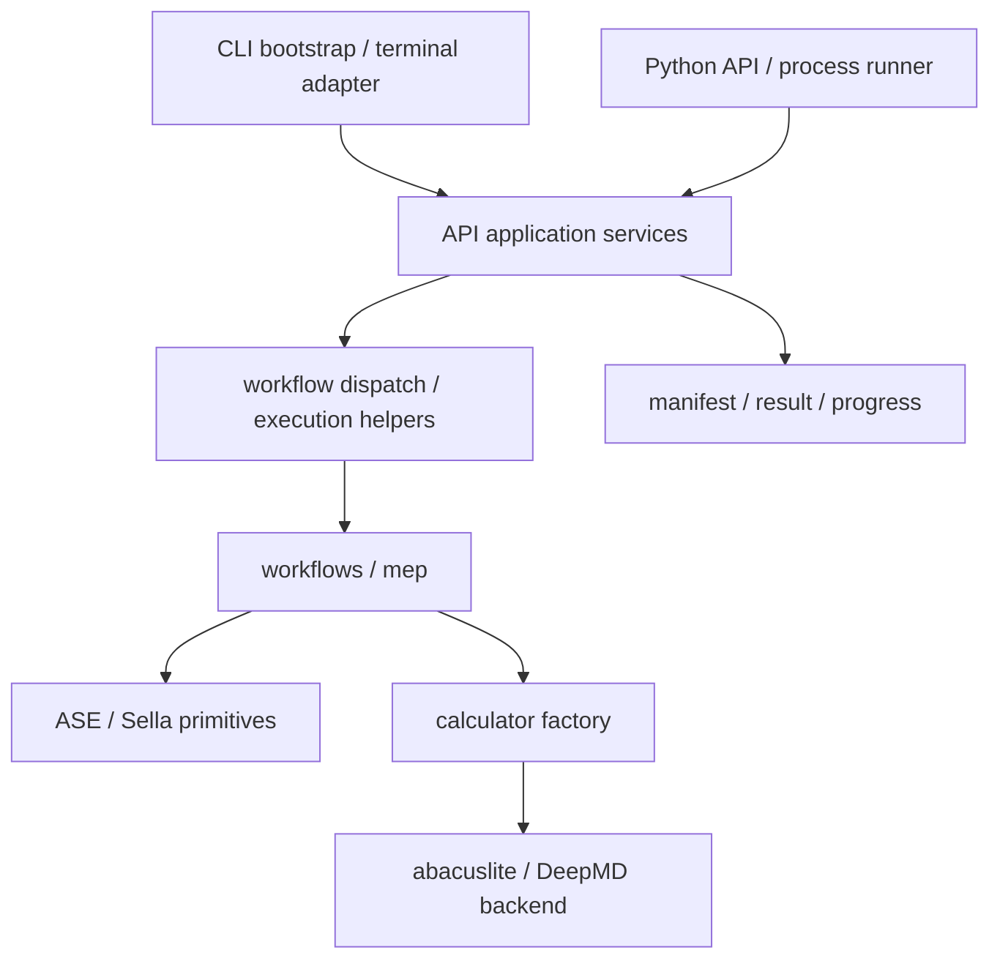

# ATST-Tools 科学行为、执行分层与开源交付设计

**版本**: 2026-10-13（rev.8，明确 ASE 过渡态计算与 CLI/Agent 共用定位）
**日期**: 2026-10-13
**状态**: 已确认；本地整改验收完成，未发布（见 §10）
**责任人**: ATST-Tools maintainers

## 1. 目标、依据与实施边界

用户在局部实施后进一步明确项目目的：基于 ASE 调用 ABACUS/DP 开展过渡态计算，
同一科学执行能力同时供 CLI/YAML 与 Agent Python Interface 消费。后续优化均以
科学输入正确性、阶段事实、可复现结果交接及双入口一致性为依据；公共执行层继续
按 §4 收敛，runtime/bench 和辅助 workflow 支持该科学目的。

用户于 2026-10-13 确认采用聚焦 brainstorming：从已发现的三个问题向上检查
科学几何契约、公共执行层、分发验证和文档事实来源。本文件是 Markdown 规范源，
用于收束关联设计；局部实施进度见 §9，不表示全部问题已修复、GPU 科学计算已重跑或版本已发布。

依据：[系统审查](../../reports/ARCHITECTURE_DISTRIBUTION_REVIEW_2026-10-13.md)、
[证据摘要](../../reports/data/system_review_20261013/evidence.json)、
[FastIDPP 历史科学路径比对](../../archive/reports/FAST_IDPP_ALGORITHM_COMPARISON_AND_FIX_2026-05-25.md)、
[公共 API 契约](../../user/PYTHON_API_REFERENCE.md)、
[现有 runtime 设计](2026-09-21-atst-runtime-interface-design.md)。代码基线为
`45d8c78de8a605c127cd4c36742d0c9525a0a6b6`，版本 `2.2.8`；新增审查材料与本设计
属于工作树变更。实现阶段须核对实际 import 来源，不能直接沿用环境中的另一份 editable checkout。

目标是正确处理受支持的科学输入、保持既有公共使用路径，并让干净安装产物和外部协作
可复核。采用 L2 有界工作包：几何修复、分发/Relax 修复、执行层收敛、文档交接。
若后续扩大为公共接口迁移或跨仓多阶段交付，再判断是否需要 L3 PLAN。

当前不扩展变胞路径算法、工作流插件协议或通用 calculator 注入 API；既有 CCQN
注入接口继续受现有契约保护。新的公开 YAML 字段不是这轮修复的前提。
本设计保留已定的执行完成/科学收敛、root-only 产物、设备绑定和 backend 委派契约。

## 2. 已证实问题与同类检查

局部实施后的当前目的复核和后续优先级见
[审查报告 §8](../../reports/ARCHITECTURE_DISTRIBUTION_REVIEW_2026-10-13.md#8-面向-ase-过渡态计算及双入口的复核与优化)。
新增事实：完整周期 unwrapped 多胞 IDPP 仍有非零假目标；Python Interface 的 root
进度回调异常在双 rank dry-run 中复现 peer 阻塞。Dimer 优化终止事实和 TS 筛查范围
需要补齐交接。以上未在本轮修改实现，不能覆盖 §9 已完成工作包状态；新异常策略
和验证结果的兼容语义须在对应有界任务中明确。

| 问题 | 当前证据 | 本轮范围 |
| --- | --- | --- |
| 插值 PBC/MIC 错误 | 非周期方向折返、斜胞最短映像不正确；见审查 F1 | 插值、原子对齐、IDPP pair translation 一并检查。 |
| 对齐同类错误 | `pbc=[True,True,False]`，参考 z=[0,4]、目标 z=[6,9]，实际重排成 [9,6]；正确非周期匹配为 [6,9] | 修正距离，保持元素内一一匹配和仅重排索引。 |
| IDPP 同类错误 | 非周期 H2，z=[1,8]、10 Å 胞；目标距离为 7 Å，却选择 z=-10 Å translation，静态路径 objective=0.00666389、非零力 | 统一实际 PBC 与 `mic=False` 的语义，覆盖非周期但有 cell 的输入。 |
| PyDMF MIT notice 遗漏 | 干净 wheel/sdist 均有代码、无其许可声明；见 F2 | 许可和溯源文件清单、实际产物内容检查。 |
| Relax 回退读取错误 | 公共 API + EMT 构建替身复现 UnboundLocalError；见 F3 | 正常输入、回退、缺失、restart 四分支。 |
| API/CLI 反向依赖 | `api.services` 导入 `scripts.main`，后者又导入 services；见 F4 | 执行入口下沉及 preflight 直接引用真实 helper。 |
| 文档边界不准确 | API 文档/部分 docstring 声称不启动 nested calculator MPI，但 factory 会按配置生成 ABACUS `mpirun` 命令 | 澄清应用入口与 calculator backend 责任，不改变已配置的后端启动行为。 |

上述对齐和 IDPP 数值观察已写入证据摘要的 design follow-up；并非全仓潜在问题均已
证实。其他结构读取路径的初步检查发现 Dimer/Sella/Vibration 回退后会读取结构，
未复现相同的未赋值错误；仍需针对性回归。发现无关的新问题时单独记录，不无限扩张本轮。

## 3. 科学几何契约

### 3.1 坐标、周期性与 MIC

- Cartesian 坐标和晶胞统一使用 Å。非周期方向按真实位移插值，不能因 cell 非零启用周期性。
- 周期方向采用尊重实际 `Atoms.pbc` 的最短映像；斜胞不能用 fractional component
  rounding 代替一般 MIC。复用 ASE `find_mic` 或等价已核验原语，不加入新的重型依赖。
- `mic=False` 禁用 pair-distance 的周期映像；`mic=True` 仍以实际 PBC mask 为边界，
  不是把三轴都强制设成周期方向。
- 支持有限、有效的部分周期晶胞，包括非周期轴为零的表示；仅用完整 cell determinant
  判断是否启用 MIC 不足。周期向量缺失/相关、非有限坐标等无效几何应有明确诊断。
- 原子对齐只在同元素内求一一匹配，保留原子数据与约束的索引对应；不改变 Cartesian
  坐标、不替用户选择不同化学通道。保留已有 `no_align`/`align_product_indices` 的语义。
- 插值端点保留用户提供的 Cartesian 坐标。中间 image 可为 unwrapped 表示；周期等价
  的终点坐标与连续路径表示分别检查，不能把正常跨胞表示误判为结构不一致。

### 3.2 晶胞有效数字与端点一致性（D1）

用户指出晶胞存在有效数字与格式转换差异。本设计明确排除逐位相等的判定。
**修订行为**：固定晶胞输入先作容差比较；容差内忠实保留各结构的 cell 原值，不因
小数噪声主动统一 metadata。超出容差或 PBC 语义不同采用已确认的 warning + 覆盖，
不因这项差异本身终止计算。用户另已确认仅 NEB 内部运行副本的必要适配（D2）。

“参考晶胞”定义为**本次固定晶胞计算实际采用的基准输入结构的 cell**，记为 `C_ref`；
`PBC_ref` 从同一结构取得。它表达计算基准，不表示该结构的有效数字更多或晶胞更正确。
默认来源按入口职责确定，与当前代码的晶胞来源一致：

| 入口 | 默认基准结构 |
| --- | --- |
| 两端点插值 / 原子索引对齐 | `start_atoms` / 显式传入的 `atoms_ref`。 |
| IDPP / NEB / AutoNEB 已有链 | 本次实际加载的链的第一个 image；重启使用恢复的有效链，而非重新读取无关的原始端点。 |
| D2S rough path | 实际传入 rough-path 阶段的初始端点 `init_atoms`。 |
| CCQN product preparation | 本次被优化的初始结构 `init_Atoms`，通常为 TS guess；嵌入式 API 中为 caller 提供的 `atoms`。product 只提供方向参考，不自动成为晶胞基准。 |

在任何 overwrite、wrap 或归一化之前取得基准和待比较结构，统一单位后记录；同一次
路径准备不按 image/迭代重新选择基准。不从旧 calculator cache、无关计算输出、两个晶胞
的平均值或所谓“精度更高”的一侧自动推断。全非周期分子的 cell 不参与几何距离，
其参考 cell 只作为现有输出 metadata 的来源。
若用户希望采用另一套晶胞，应在输入准备阶段明确选择并一致准备各结构；如何变换
坐标具有科学含义，本轮不代替用户自动执行缩放或晶格基矢变换，也不新增 cell YAML 字段。

| 项目 | 规则与依据 |
| --- | --- |
| cell 比较 | 换算 Å 后比较完整 3×3 矩阵，不只比较体积或 cell lengths；在用户提出 1e-5/1e-6 候选范围内，实施默认值目标为 `atol=1e-5 Å, rtol=0`。 |
| 容差依据 | 实施前 vendored `core.py` 默认 1e-4；§3.2.2 的日志表示差异与候选回归支持优先 1e-5，现已按用户确认在本仓修改默认值。 |
| 舍入观察 | 斜胞保留六位小数的样例 max cell delta≈3e-7 Å，可接受；0.01 Å 真实改动超出候选容差。此样例不证明任意格式/低有效数字都满足该阈值。 |
| PBC 比较 | 比较解析后的三轴布尔语义，0/1 与 False/True 的等价表示一致；布尔周期性无小数容差。格式缺失或不同默认值需要明确输入语义，不能由 cell 差异猜测。 |
| 非周期分子 | 全部 PBC 为 False 时 cell 不参与几何距离；允许零 cell 或有限包围盒，不把两者差异当变胞路径。 |
| 容差内 cell 差异 | 原文件、caller 对象及预处理返回结构保留各自 cell 原值，无需 warning；几何比较不产生 metadata overwrite。参考 cell 用于定义比较基准，不要求把相近晶胞改写成相同数组。 |
| 超差/PBC 真不一致 | 用户已选择 warning + 覆盖：在覆盖前记录原值并发出英文 warning，说明参考来源、max cell delta/容差或 PBC 不一致轴，再在副本上采用 `C_ref/PBC_ref`；不因差异本身报错。 |

校验需覆盖公共路径预处理、D2S 和 CCQN product preparation，避免某个 caller 在
校验前 `set_cell/set_pbc` 已抹去原始差异。容差区分原样保留的小数噪声与需要 warning
的覆盖，不证明超差晶胞在物理上等价。覆盖只改变 cell/PBC metadata，不执行不同晶格
基矢、旋转、超胞或真实应变对应的坐标变换。实现中不根据输入差异无界放宽容差。
容差边界、单位和归一化行为写入长期用户参考，不新增多套不同默认值。

Ruling D1（2026-10-13，用户确认）：采用 warning + 覆盖，保留参考结构作为计算基准，
同时使原先超差/PBC 差异的静默覆盖可见。代价是超差输入仍可运行，但实际采用参考边界而非原目标
边界；warning 必须明确这一事实。已有非有限坐标、损坏数据和无效参考周期晶胞的
几何检查继续生效，warning + 覆盖不能把损坏输入伪装成有效结果。
每份输入在路径准备时报告差异，避免每次 force evaluation 重复 warning；在已有 root
输出上下文中由调用层协调输出，不要求几何原语自行启动或创建 communicator。

### 3.2.1 ASE NEB 运行边界（D2 已确认）

本地 ASE 3.28.0 的 `BaseNEB.__init__` 对每个周期晶胞向量检查绝对分量差异是否
超过 `1e-8 Å`，PBC 必须一致。10 与 10.000003 Å 的周期向量差异为约 3e-6 Å，
虽在本设计候选容差内，原样构造 NEB 仍复现 `NotImplementedError`。
因此预处理保真不能直接保证所有容差内输入都可交给当前 ASE NEB。

对于容差内差异，用户已确认：原文件、caller 与预处理结果保持原值；只在 ASE NEB/AutoNEB/DyNEB
运行确实需要时，在工作流拥有的内部运行副本上采用参考 cell，记录适配前差异和
实际计算 cell。该步骤位于端点结果验证/计算和 optimizer 构造之前，缓存身份重新
核验，保持 Cartesian 坐标和约束；实际轨迹记录运行晶胞，不能伪装成原晶胞。
该适配不应为了非周期方向的差异而无条件改写晶胞，也不放宽 ASE 源码的检查。

Ruling D2（2026-10-13，用户确认）：允许所述内部运行副本适配，保留输入/预处理保真，
并明确记录实际采用的计算晶胞。无需修改 ASE 的阈值或绕过其检查；其他不要求共同
晶胞的几何路径不引入这一适配。该确认不表示代码已实现或已通过实际计算。

### 3.2.2 阈值用途与当前合理性核验

| 阈值 | 检查对象 | 当前判断 |
| --- | --- | --- |
| ASE NEB `1e-8 Å` | 运行 image 的周期晶胞向量分量是否近乎相同；PBC 必须一致 | 作为固定晶胞算法入口的工程约束合理，不能当作跨格式输入舍入容差；保留 upstream 检查，在运行副本适配。 |
| vendored abacuslite `1e-5 Å, rtol=0`（本地未发布修改） | 本次 STRU 与输出帧的完整 cell 矩阵，以及周期等价 Cartesian 坐标残差 | 从原 1e-4 收紧；候选回归见下文，实施证据见 §9。此值不是 SCF 收敛或 fmax，外部独立包不由本仓修改。 |
| ATST 默认值目标 `1e-5 Å, rtol=0` | 输入 cell 差异是容差内保留还是 warning + 覆盖 | 统一项目自有判定的数值默认值，不合并不同职责，也不声称 ASE 接受原始运行 image。 |

本地 ASE 3.28.0 源码与[官方 NEB 源码说明](https://docs.ase-lib.org/_modules/ase/mep/neb.html)
一致。以上“合理”是基于接口行为与现有证据的工程判断，不声称 ASE 作者已给出
普适物理误差推导，也不把 1e-8 说成双精度浮点表示的极限。

本仓 `multiframe_scf_trial_last` 夹具对应当前 STRU 的第 0 帧，cell max delta 为
`6.6590e-7 Å`，坐标残差为 `3.9954e-7 Å`。默认 1e-4 匹配，而 1e-8 误拒；
其余三帧坐标残差约 0.2/0.5/0.4 Å，被 1e-4 拒绝。该证据支持当前默认值处理
序列化/单位换算噪声，不能单独证明适用于任意大晶胞、输出精度或轨迹变化。
本地 NEB 构造 probe 也确认内部副本适配后通过，原始 cell 和 Cartesian 坐标不变；
没有调用能量/力 backend。数值原始观察保存在证据摘要。

用户随后提出将匹配默认值统一到 1e-5 或 1e-6。对保留的 11 份日志做同一晶格常数的
Bohr/Å 打印表示比较，最大换算差异 `4.7564e-6 Å`；由 ZnO SCF 日志两种打印表示推算的 cell 分量差
约 `7.6102e-6 Å`。这两种打印表示不是原始 STRU/运行日志完整配对验证，但直接说明
现有表示精度可低于 1e-6。五位小数的 10.1234567→10.12346 Å 也产生约 3.3e-6 Å
舍入差异。因此 1e-6 不能作为这些混源输入的普遍默认值。

候选默认值在独立进程中通过内存 wrapper 注入；只替换未显式传入的 `atol`，不修改
源代码或旧测试的显式容差。1e-5 和 1e-6 均通过 33 项帧选择回归，各有 10 次候选
默认调用与 16 次显式容差调用。相同测试都通过不等于两个候选同样稳健；上述日志
表示差异提供优先 1e-5 的额外依据。配对金样在两候选下均匹配当前帧、拒绝其余帧。

Ruling T1：在用户提出的候选范围内选择 `1e-5 Å, rtol=0` 作为 ATST 输入判定与
本仓 vendored frame matcher 的实施默认值目标，比旧 1e-4 收紧一档，给已观测的
格式误差保留余量。ASE upstream 仍保留其 1e-8 固定晶胞硬检查，通过已确认的 D2
运行副本适配满足；不修改环境中的 ASE，也不复制其 constructor 只为改变常数。
代价是旧日志在 1e-5–1e-4 区间的误差可能被新 matcher 拒绝，实施阶段必须检查
对应输入/输出和兼容范围，不能用现有小样本宣称所有旧格式都不会回归。

abacuslite 当前同一 `atol` 同时用于 cell 和坐标残差；合理性应分别看二者的打印精度。
真实结构差异小于匹配容差时可能同时被接受，这是身份近似判定的边界，不能据此保证
能量/力科学误差。对于大晶胞或较低精度输出，应按实际格式和误差预算校准，不能自动
放宽。实施新默认前补直接在原代码上覆盖 1e-5 两侧的行为回归，核验当前支持的
同源输入/输出。若发现正常格式所需误差预算超出目标值，先查单位/解析精度与实际
支持范围，不无声退回宽容差；必要时再分别评估 cell/position 容差。
vendored 默认值修改需按既有纪律同步 PATCHES、SNAPSHOT 差异说明与 drift-check 补丁
身份，行为证据先于登记值更新。本轮不新增任意调参的 YAML 入口。

### 3.3 IDPP 方法、等距选择与兼容证据

保留当前 pymatgen-compatible NEB-like IDPP 更新、固定 pair translation 的方法、
约束投影和收敛记录；不因 MIC 修复改用另一个 objective optimizer。
历史 Cy-Pt 证据表明同名 IDPP 不等于同一科学路径。

Ruling G1：科学几何正确性优先；保留已验证输入域的行为与确定性，不保护已复现的错误
折返或无效周期映像。代价是部分输入的路径变化，须记录影响与新证据。

等距映像应可重复且保持成对 translation 反对称性。原有 tie ordering 在候选具有合法
PBC 且距离正确时优先保留；不能把固定 27 候选扫描当作所有斜胞/多胞位移的真值。
测试中的逐位比较用于保护算法优化的已验证范围；新增一般 MIC 的独立参照必须检验
实际距离、PBC mask、约束和路径，不能只与另一个同源函数互相比较。

实施前保留旧基线结果，对有效旧案例比较几何与方法行为；错误输入验证新正确结果。
对出现路径变化的既有科学案例说明原因并作相称验证，不通过改写历史 curated output
伪造复现。需要真实 ABACUS/DP 计算时遵循维护者 GPU/Slurm 约定，CPU/EMT 回归不冒充科学验收。

## 4. 公共执行层与责任归属

内部迁移目标是把 `scripts.main` 的 runner 和执行 helper 下沉到 workflow 执行模块，
把 templates/argparse 保留为 CLI 职责。`api.services` 不再通过 CLI 获得工作流或
`run_abacus_check_input_dry_run`，preflight 直接引用 `utils.abacus_io`。
代码落点以最少职责清晰的内部模块为准，不建设插件协议或多个并行 registry。

| 责任 | 归属与必须保持的差异 |
| --- | --- |
| CLI | 参数、终端日志、既有 exit behavior、模板；import-light bootstrap 在科学库前完成绑定。 |
| API services | 配置归一化、typed errors、rank failure synchronization、progress/result envelope；stable root imports 保持。 |
| workflow/MEP | 科学算法与阶段事实；被调用的优化器提供 convergence，不由事后轨迹猜测。 |
| artifact manifest | 科学阶段事实的持久权威；D2S/AutoNEB 聚合子阶段，root 拥有顶层产物。 |
| 两入口兼容 | API 补齐 manifest 的行为与 CLI 不合成 API 产物的行为分别保留；API preflight 以 cwd 为基准，legacy CLI preflight 的 YAML-parent 语义保留。 |
| calculator/backend | 执行用户配置的 calculator command，包括既有 ABACUS MPI profile；应用入口不申请 Slurm 资源或自动启动外层 image MPI。文档不能把后端执行能力写成完全禁止。 |
| runtime/bench | 设备与线程、已有进程入口和测量；保持当前绑定、隔离、每 case workdir 与计量边界。 |

`status=complete/success` 继续表达执行完成，`converged=true/false/null` 表达科学终止事实，
不改变退出码把 unconverged 自动变异常。CCQN supplied calculator 不重配后端；
external-abacuslite-first/vendored fallback 与 DP 官方 ASE calculator 入口不变。

## 5. 分发与验证契约

- wheel：Python 运行模块、必要运行资源、项目与第三方版权/许可文本、精简 vendored
  provenance；PyDMF 来源补公开 URL、基线 SHA 与 MIT notice；abacuslite 保留基线/补丁指针。
- sdist：可从其内容重建 wheel，包含同一许可与 provenance 清单；本轮沿用 PyPI
  分发 Python 包的产品定位，不承诺它等同完整开发 checkout，也不强塞全部报告与模型。
- GitHub checkout：贡献者测试、fixtures、示例、开发文档与发布工具的规范源；Gitee
  继续维护者手动同步的只读镜像。大模型和计算输出按现有受控路径管理。
- 显式 license-files/package-data 控制非 Python 文件。校验许可正文和版权主体在
  两种产物中保留；LGPL 根文本不能替代 PyDMF MIT notice。项目 metadata 与第三方
  许可范围核对后准确表达，许可证本身不由本设计重新授予。
- 当前/发布产物分别记录身份；已有发布包可只读下载核查。修复通过新版本交付，不能
  默认为已发布 2.2.8 的文件已更新。版本变更、标签和发布范围遵循现有 release 契约。

验证分为行为回归、干净 checkout/构建、安装后使用、科学案例证据四层，各层只证明
自己的范围。必要的新检查是产物许可内容和科学几何边界，不以增加测试数量为目的。
每次验证记录 Python、实际 module 路径、源码 revision 或 artifact 身份及关键依赖。
对纯文档、局部修复和行为等价迁移采用相称检查，源码未改不重复完整计算。

## 6. 文档事实来源与协作入口

| 事实 | 规范来源 | 消费入口 |
| --- | --- | --- |
| 当前版本 | `pyproject.toml` | runtime metadata；README 用短说明并链接发布记录。 |
| YAML 类型/默认值 | `config_schema.py` | 生成变量表；手写参考解释行为与适用边界。 |
| API/result/MPI 契约 | `PYTHON_API_REFERENCE.md` 与相关设计 | CLI/API/消费端说明及行为测试。 |
| 发布源码/CI/artifact | 对应 release notes 的可复核证据 | README、发布教程与状态页引用，减少多处复制 SHA。 |
| 当前支持与限制 | `FEATURE_STATUS_MATRIX.md` | 用户导航与管理入口；区分存在、验证与发布状态。 |
| 设计与实施状态 | 本 spec、现有 specs/plans；文档账本登记 | 报告保留审查证据，完成结论吸收后按已有生命周期处置。 |

长期开发者入口补新环境、editable 安装、import 路径、普通/可选测试、格式检查和
fork/PR 路径；HANDOVER 保留维护 checklist，operations guide 保留站点操作。
代码架构说明集中于一个长期开发者入口，描述上节依赖方向与新增 workflow 路径。
不复制一套规范到新目录；保留现有用户/开发者/项目管理者三条文档路径。

修正已知发布 SHA 和候选/已发布文字矛盾时先核验正式记录。语义一致性检查聚焦
版本/tag/SHA 和产物 notice，不把自然语言准确性完全归给链接/metadata checker。
本设计登记在账本；实现和报告状态不能因为文档已生成而写成已完成。

## 7. 工作包与可观察验收

| 工作包 | 验收标准 | 已有检查可复用范围 |
| --- | --- | --- |
| A 几何修复 | 非周期/部分周期/斜胞/多胞位移、cell 舍入、等距映像、约束；caller 与原缓存不被修改；容差内预处理保留 cell，超差/PBC 不一致 warning 后覆盖且不缩放坐标；NEB 仅在内部运行副本必要适配并记录；metadata 改变时不沿用未经验证的 endpoint energy/force | `test_idpp.py`、`test_ccqn.py`、`test_workflows.py`、examples；新增失败回归先证明原症状。 |
| B 分发与 Relax | 干净 wheel/sdist notice 正文完整；重建/安装正常；Relax 四条路径正确 | package metadata/workflow/API/CLI tests、build、strict Twine、clean-wheel gate；新增 artifact 检查。 |
| C 执行层收敛 | services 不反向导入 CLI；既有入口/错误/文件/cwd/MPI/运行绑定行为等价 | CLI/API/runtime/MPI 回归和安装包验证；基线/候选对照，不为重构制造测试先行记录。 |
| D 文档交接 | 新环境可按文档完成贡献准备；发布来源一致；能力限制与证据层级明确 | docs governance、生成文档同步、相关文档测试；检查实际可操作路径。 |

A 与 B 可以独立推进；C 不作为三项缺陷修复的前提，D 随相应实现同步。修复本身不要求
重做全部算法或覆盖所有未知功能。最终使用当前家族独立 reviewer，核对科学边界、
兼容性与交付证据；跨家族审查按既有治理约定判断，不新增硬门。
版本归类以实际兼容性结论为准。D1 已保留差异输入可运行的策略；几何修复仍可能改变
受影响的路径结果。若实现改变已有受支持输入契约，不得把它混入只允许兼容增量的
2.x minor/patch 序列；须记录支持边界或迁移策略，由维护者判断
发布范围。本文件不预定版本号，不将所有新增输入校验自动称为兼容 bug fix。

## 8. 已确认决定与后续

- 已确认方向：科学行为、公共执行层、交付验证与文档事实来源的有界完善；L2 分包实施。
- 已有契约复用：ASE/backend 定位、现有 IDPP 更新方法、稳定 API、root/MPI/cwd、
  convergence、runtime、分发渠道与文档生命周期；不重新索取这些已定选择。
- 用户新增要求：晶胞存在有效数字问题，必须允许数值容差，不能要求逐位相等。
- **D1 已确认**：用户在明确参考晶胞来源后选择 warning + 覆盖。cell 使用数值容差，
  超差或 PBC 语义不同先警告再采用参考 metadata，保留 Cartesian 坐标；不再提出
  相同决策供重复确认。用户随后修订容差内行为为忠实保留原 cell，不统一预处理副本；
  数值阈值仍作为有依据的实施候选由边界测试核验。
- **D2 已确认**：用户接受 NEB 所需的内部运行副本统一与实际计算边界记录，保留
  原输入及预处理结果；阈值用途与目前合理性已核验于 §3.2.2。
- 用户提出默认值收紧范围 1e-5/1e-6；T1 依据比较结果选择 1e-5；用户随后明确确认
  两层处理做法并授权推进。ASE 固定晶胞检查不改，当前实施状态见 §9。

本轮设计澄清已收束；已确认方向与 D1/D2 不重复询问。后续按 L2 工作包
实施与验证。设计状态不是代码完成状态；分发许可与 Relax 原缺陷的结论独立成立。

复核记录：2026-10-13，当前家族独立 `gpt_final_reviewer` 未发现阻止 D1 确认的重大
设计问题；复现构造细节与缓存身份验收两项建议已补齐。文档治理与 26 项相关测试通过；
前期设计复核时尚未修改源码；后续局部实施不修改 ASE 源码或 IDPP 的 NEB-like 优化方法。

## 9. 晶胞容差与运行交接实施（2026-10-13）

本地未发布工作区已实现 D1/D2/T1。`utils/geometry.py` 统一私有副本、绝对 cell
比较、超差/PBC warning、缓存失效与边界记录；路径生成、索引对齐、IDPP 和 CCQN
product 复用该层。分段路径始终保留初始输入的共同参考，避免两个各自合格的舍入
值在子段中被误判为超差。NEB、AutoNEB 和 D2S rough DyNEB 在端点校验/计算前准备
运行图像；AutoNEB restart 实际加载已恢复的 per-image 文件。

独立审查发现 AutoNEB 后续子带可能以内部 image 为首帧：`+9e-9/-9e-9 Å` 各自相对
第 0 帧合格，但子带周期分量跨度 `1.8e-8 Å` 会被 ASE 拒绝。实施已改为检查输入覆盖
规则之后的全链周期分量跨度；必要时统一相关运行副本，使所有后续子带满足检查，
不修改容差内非周期行。真实 AutoNEB CI 子带 `[1,2,3]` 纳入回归。

实际运行轨迹保留采用的晶胞；`info.atst_cell_preparation` 和 manifest 的
`metadata.fixed_cell` 记录原值、参考值、实际值与原因。改 cell/PBC 后清除 SPC、
端点标记和恒电势事实，`auto` 重算，`never` 缺有效结果时报错；D2S 不再在校验后
重新贴回旧缓存。vendored SCF 默认值已改为 `1e-5`，先用 cell/position 两侧回归
确认行为，再登记 PATCHES/SNAPSHOT 和 AST 身份，钉扎上游基线 SHA 不变。

Cartesian/MIC 插值与对齐修正了零晶胞分子、部分周期和斜胞端点距离；IDPP 仅在有
PBC 时启用 MIC，部分周期的固定 pair translation 使用 ASE 几何。完整周期 IDPP
的有限 27 候选扫描仍保留，未宣称所有多胞/高度斜胞情况已修复。分发许可、Relax
回退、执行层拆分和其他交付工作包仍待实施。当前验证范围与结果见
[审查报告实施补充](../../reports/ARCHITECTURE_DISTRIBUTION_REVIEW_2026-10-13.md#7-晶胞容差与-neb-运行交接实施补充)。

## 10. 实施收口（2026-10-15）

§2/§7/§9 保留设计与局部实施时的状态。后续整改现已完成本地验收：一般 MIC/IDPP、
Relax/分发、MPI 回调失败同步、Dimer 阶段事实、显式 TS 验证、公共执行层和后端身份
均已落地；兼容矩阵已配置。TS 验证只消费显式请求与既有数据，缺失范围和约束范围
不一致保持 unknown；API/CLI 不启动外层 MPI，calculator 执行已配置后端命令。
最终证据、独立复核及未运行边界由
[系统审查 §9](../../reports/ARCHITECTURE_DISTRIBUTION_REVIEW_2026-10-13.md#9-双入口整改集成2026-10-15未发布)
承载。本地验收不等于发行、GPU 科学验收或平台 P6 完成。
