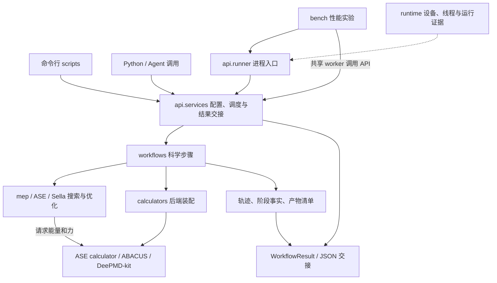

# ATST-Tools 源码导览

**版本**: 2026-10-16
**日期**: 2026-10-16
**状态**: 维护
**责任人**: ATST-Tools maintainers

本页是开发者与项目管理者的源码架构指南：解释各模块为什么存在、主要内容和修改入口。
ATST-Tools 围绕 ASE 组织过渡态及相关科学计算，以 abacuslite 和 DeePMD-kit 提供计算
后端，通过 CLI/YAML 和 Python API 交付同一套工作流。

阅读时可先按问题定位：**执行科学计算看 `workflows/` 与 `mep/`，接入调用方看
`api/` 与 `scripts/`，管理运行资源看 `runtime/`，比较性能配置看 `bench/`。**
本文描述当前 checkout；能力成熟度、已知问题及发行边界统一查
[功能矩阵](../../docs/reports/FEATURE_STATUS_MATRIX.md)，避免从目录存在推断功能已验收。

## 1. 各模块的目标与主要内容

| 目录 | 为什么存在、主要负责什么 | 建议先读 |
| --- | --- | --- |
| [`api/`](api/) | 为 Python 程序、Agent 和外部宿主提供稳定调用与结果交接。包含配置校验、工作流调度、类型化错误、结果对象、进程 runner，以及显式的已存结果验证入口。 | [`__init__.py`](api/__init__.py) 看公开导出；[`services.py`](api/services.py) 看服务流程；[`models.py`](api/models.py) 看输入选项和结果。 |
| [`scripts/`](scripts/) | 将命令行请求转换为服务调用，提供参数、子命令、配置模板和终端输出。轻入口先处理资源启动，再加载科学实现。 | [`cli.py`](scripts/cli.py) → [`cli_impl.py`](scripts/cli_impl.py)；`atst run` 的适配与模板在 [`main.py`](scripts/main.py)。 |
| [`workflows/`](workflows/) | 组织一次科学任务的步骤、输入、重启与交付。包含 Relax、Vibration、D2S、IRC、MD、DMF、恒电势工作流，以及 NEB 等共享执行入口。 | [`execution.py`](workflows/execution.py)；复合流程可读 [`d2s.py`](workflows/d2s.py)，简单流程可读 [`relax.py`](workflows/relax.py)。 |
| [`mep/`](mep/) | 承载最小能量路径（MEP）及过渡态搜索组件：NEB、AutoNEB、Dimer、Sella 的项目适配，以及 CCQN 实现。由科学工作流调用和组合。 | [`neb.py`](mep/neb.py)、[`autoneb.py`](mep/autoneb.py)、[`ccqn.py`](mep/ccqn.py)。 |
| [`calculators/`](calculators/) | 把配置装配成 ASE calculator，统一 ABACUS/DP 后端选择、命令与模型设置、后端身份记录；恒电势装饰器在固定几何下迭代电子数。 | [`factory.py`](calculators/factory.py)、[`abacuslite_backend.py`](calculators/abacuslite_backend.py)、[`dp.py`](calculators/dp.py)。 |
| [`runtime/`](runtime/) | 让一次运行获得明确的设备、线程与进程环境，并留下实际运行证据。包含设备解析、worker 启动、绑定校验、采样和调用计数。 | [`cli_dispatch.py`](runtime/cli_dispatch.py)、[`launch.py`](runtime/launch.py)、[`evidence.py`](runtime/evidence.py)。 |
| [`bench/`](bench/) | 为维护者组织有限批次的性能实验：运行一组案例、扫描并发配置、重复测量和保存测量来源。普通单次科学计算无需经过它。 | [`batch_runner.py`](bench/batch_runner.py)、[`sweep.py`](bench/sweep.py)、[`record.py`](bench/record.py)；用途见 §3。 |
| [`utils/`](utils/) | 保存跨工作流复用的配置、结构与几何处理、MPI 协调、产物和收敛事实、后处理与绘图工具。 | 配置从 [`config_schema.py`](utils/config_schema.py) / [`config.py`](utils/config.py) 开始；结果从 [`artifacts.py`](utils/artifacts.py) / [`convergence.py`](utils/convergence.py) 开始。 |
| [`external/`](external/) | 保存有明确来源与维护记录的第三方代码快照：abacuslite ASE interface 和 PyDMF。 | [ABACUS 快照基线](external/ASE_interface/ABACUSLITE_SNAPSHOT.md)、[补丁记录](external/ASE_interface/PATCHES.md)、[PyDMF 来源](external/pydmf/UPSTREAM.md)。 |

包根的 [`__init__.py`](__init__.py) 主要提供版本查询；版本源是仓库根
[`pyproject.toml`](../../pyproject.toml)。对外集成优先使用 `atst_tools.api` 的公开导出，
具体契约见 [Python API 参考](../../docs/user/PYTHON_API_REFERENCE.md)。内部文件路径
用于开发定位，不自动成为稳定外部接口。

## 2. 一次科学计算如何经过这些模块

下面以配置驱动的 `atst run` / `run_workflow` 为主线：

以 NEB 为例，CLI 将请求交给 `api.services`；服务层归一化 YAML、确定 MPI world，
再调用 `workflows.execution.run_neb`。执行层准备图像、端点和 calculator，调用
选定的 NEB 实现与 ASE 优化器，记录轨迹和收敛阶段；API 读取或补齐产物清单并构造
结果。CLI 保留终端展示，进程 runner 在 root rank 写出 JSON，具体交接差异见 API 参考。

这张图覆盖工作流主线。配置检查、轨迹分析、绘图等轻量命令可以直接使用对应工具；
嵌入式 `run_ccqn` 可以直接调用 MEP 组件。`validate_ts` 读取已有振动和冻结结构事实，
本身不会启动新的科学计算。

几个会影响修改位置的分工：

- **`workflows` 与 `mep`**：前者负责“这次任务有哪些科学步骤”，后者负责具体搜索
  组件。例如 D2S 组织端点优化、粗路径和单端精修，精修可调用 Dimer、Sella 或 CCQN。
  当前一些 `mep` 类也管理轨迹、calculator 和阶段事实，不能将现状理解为严格的纯算法层。
- **`api` 与 `scripts`**：API 管理程序调用契约，CLI 管理命令行表达；科学执行应由
  共享层承担。API 不依赖 CLI 模块来运行计算。
- **`calculators` 与 `external`**：前者承担本项目的装配和适配，后者保留第三方实现。
  ABACUS 优先使用独立安装的 abacuslite，仅该包缺失时回退到 vendored 快照；
  DP 使用 DeePMD-kit 的 ASE calculator。上游快照修改需登记来源和补丁。
- **`runtime` 的启动时机**：设备和线程环境需要在科学库初始化前生效，因此轻入口及
  `api` 导出采用延迟加载。嵌入式 API 在调用方现有进程中运行，不会自动创建隔离 worker；
  进程隔离由 CLI/runner 的资源启动路径负责。采样和计数服务于观测，不决定科学收敛。

目录表达主要职责，不代表所有文件都遵守严格的单向分层。例如 `runtime.errors`
复用 `api.models` 的轻量错误类型；`utils.geometry` / `neb_endpoints` 为了清理或校验
恒电势事实，会依赖对应 calculator 模块。新增代码应按具体职责选择依赖，不能把
`utils` 当成没有领域依赖的公共底层。

## 3. 为什么有 bench：性能实验的组织工具

`bench` 是 benchmark 的缩写，源于项目的共享 GPU 节点与 DP 推理调优工作。
它用于回答：同一批计算逐个执行或并发执行，哪种总耗时更短；线程数和 MPI 图像布局
怎样影响吞吐；共享进程能否减少模型加载成本；重复测量是否仍能得到相同结论。

例如，对同一组 NEB/Relax 配置，比较每张卡同时运行 1、2、3 个案例，各重复 3 次。
这些计算仍由已有工作流完成，bench 组织执行顺序、资源预算、失败/超时记录及性能汇总。
只有相应计算结果也得到科学验证，性能比较才能用于支持运行策略。

| 组件 | 做什么 | 主要产物 |
| --- | --- | --- |
| [`batch_runner.py`](bench/batch_runner.py) | 在已经获得的资源内执行有限 case 清单，按设备槽位与 CPU 线程预算安排 worker，处理超时、失败和取消。 | `case_report.json`、`batch_summary.json`、worker 标准输出/错误日志。 |
| [`batch_worker.py`](bench/batch_worker.py) | `--share-worker` 模式下，在同一子进程内依次调用工作流，支持复用 DP 模型及预热状态。默认模式则每个 case 使用独立 runner 进程。 | 各 case 的 `atst_api_result.json` 和供批次汇总读取的进度行。 |
| [`sweep.py`](bench/sweep.py) | 扫描设备槽位并发数，重复执行同一清单并交替变体顺序，汇总整批耗时与成功案例吞吐。其他线程/launcher 配置由案例清单控制。 | `sweep_summary.json`，以及每个变体、每次重复的批次目录。 |
| [`record.py`](bench/record.py) | 记录代码修订、环境、输入夹具和结果文件身份，关联运行时记录与操作者提供的作业信息。 | `bench_record.json` 等测量记录，缺失信息显式标记。 |

`runtime` 提供设备绑定、线程环境和采样等单次运行能力；`bench` 使用这些能力安排和
比较一组运行。二者都在调用方已有资源内工作；bench 不申请 Slurm 资源，也不充当
长期生产队列。普通用户继续使用 `atst run` 或 Python API，项目没有新增 `atst batch`
公共命令。维护者使用 `python -m atst_tools.bench.<组件>`，详细命令和约束集中在
[HANDOVER 的 bench 小节](../../docs/developer/HANDOVER.md#71-新增或修改基准工具链bench)。

性能实验需要分清源码、案例与实际运行目录：

| 位置或概念 | 承载内容 |
| --- | --- |
| [`examples/`](../../examples/README.md) | 用户案例、配置、输入和精选参考结果；可被性能实验选作负载。 |
| [`tests/`](../../tests/) | 行为验证代码和夹具，运行时通常使用临时目录。 |
| 每个 case 的 `workdir` | 本次科学计算的读写现场：轨迹、重启数据、后端输出、产物清单及相关缓存。它是运行位置，不要求仓库存在固定的 `workdir/` 目录。 |
| bench 的 `--out` | 批次和 case 报告、扫描结果；可以包含各 case 的工作目录，二者也可以分开配置。 |

未指定 `workdir` 时使用配置文件所在目录；显式相对路径以 `--out` 为基准，绝对路径
直接使用。bench 不自动复制输入。多次运行可以共享只读结构或模型，但需要正确解析
输入路径并隔离可写产物。当前实现的已知限制见功能矩阵中的审查入口，不能把目录规划
意图当作所有输入组合都已验证。

## 4. 修改什么，从哪里开始

| 修改目标 | 源码起点与联动位置 |
| --- | --- |
| 新增或修改科学工作流 | [`utils/config_schema.py`](utils/config_schema.py) → 对应 `workflows/` / `mep/` → [`api/services.py`](api/services.py) 的调度和结果交接；共享执行 helper 放 `workflows/execution.py`；同步配置模板、用户说明、案例及对应验证。 |
| 调整 NEB/TS 搜索过程 | 对应 `mep/` 实现及调用它的工作流；几何、端点和重启行为分别查 `utils/geometry.py`、`neb_endpoints.py`、`restart_helpers.py`。 |
| 接入或调整计算后端 | `calculators/factory.py` 及后端适配文件；同步 backend identity。涉及 vendored 代码时遵循快照基线和补丁记录。 |
| 新增 YAML 字段或 CLI 命令 | YAML 从 schema 与 [`config_docs.py`](utils/config_docs.py) 开始；CLI 从 `scripts/cli_impl.py` 的子命令路由开始，`atst run` 相关适配在 `scripts/main.py`。保留轻量 bootstrap 的导入边界。 |
| 修改结果/收敛交接 | `utils/artifacts.py`、`convergence.py` 与对应生产者；检查 `api/models.py`、`services.py`、[`utils/summary.py`](utils/summary.py) 及外部消费者的路径和协议语义。 |
| 调整资源分配或性能实验 | 单次设备/线程/启动看 `runtime/`；批次预算、共享 worker、扫描与测量记录看 `bench/`；科学步骤继续由已有工作流实现。 |

仓库根 [`scripts/`](../../scripts/) 放文档检查、构建验收、参考结果生成等维护脚本；
它与包内 `src/atst_tools/scripts/` 的安装后 CLI 职责不同。

具体开发环境、变更后的检查及文档同步要求见
[HANDOVER](../../docs/developer/HANDOVER.md)，配置治理见
[YAML_INPUT_GOVERNANCE](../../docs/developer/YAML_INPUT_GOVERNANCE.md)，验证操作见
[EXAMPLE_VALIDATION_OPERATIONS](../../docs/developer/EXAMPLE_VALIDATION_OPERATIONS.md)。
文档目录和事实来源见 [DOCS_ARCHITECTURE](../../docs/developer/DOCS_ARCHITECTURE.md)。
新增目录、改变模块职责或主要调用关系时同步本页；版本状态和逐次验证结果继续维护在
功能矩阵、release notes 和报告中。

## 5. 后续迭代应保持的设计边界

当前采用一个 Python 包内分模块协作的结构：ASE 对象和 calculator 接口连接科学
组件，CLI/YAML 与 Python API 共用执行实现。现有规模适合保持这一结构；扩展时先
复用已有组件和契约。以下是设计约束，具体路径是否完整满足仍以测试和功能矩阵为准。

| 设计边界 | 维护要求 |
| --- | --- |
| 科学实现与入口分开 | 科学步骤进入 `workflows`，搜索组件进入 `mep` 或复用 ASE；CLI 和 Agent 接口不各自维护一套算法。已有 MEP 任务适配器可随实际扩展逐步整理，保留兼容入口。 |
| 后端以 ASE 接口交付 | 工厂负责配置装配，能量、力及受支持的其他性质交由 calculator 提供。`BaseCalculator` 当前没有实际接入点；新增后端不必继承它。 |
| 事实由实际生产者负责 | 优化器/工作流记录阶段收敛，外层复合任务聚合子阶段；API 负责交接。执行完成、优化收敛、TS 验证分开表达，缺失事实保留 unknown。 |
| 结构与结果共同校验 | 重启和多端点路径必须确认原子身份、顺序、晶胞/PBC 与图像布局。复制几何、复制有效冻结结果、主动调用后端求值是不同操作，按用途选择 helper。 |
| 文件与协议有共同语义 | manifest 用可选 `path_base` 明确相对产物的基准，API 重写时保留；恒电势 facts-v1 写出保留旧 reader 所需的兼容字段，并用历史 reader 验证。协议名称相同不代替互读检查。 |
| 运行资源有明确归属 | 调用方取得外层资源，bench 在其内安排案例，runtime 建立单次运行环境；采样只记录事实。工作目录、线程与设备约束须在 worker 启动前一致，避免科学代码承担批次调度。 |

新增 workflow 要同时检查 schema、模板、服务调度、manifest、返回结构和可选
profiles/plots；接入清单见 [HANDOVER §2](../../docs/developer/HANDOVER.md#2-新增或修改-workflow)。
本次架构判断、依赖例外和整改顺序见
[2026-10-16 架构复核](../../docs/reports/ARCHITECTURE_REVIEW_2026-10-16.md)；九项缺陷的
局部修复、回归及旧数据迁移说明见
[整改验收](../../docs/reports/MAIN_REVIEW_FIXES_2026-10-16.md)。这些源码修复尚未发布。
