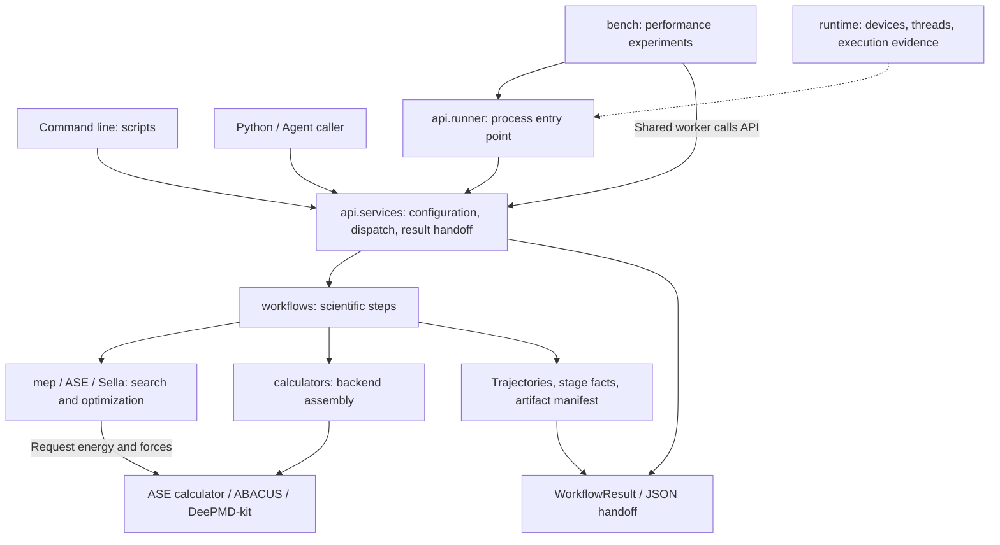

# ATST-Tools source architecture

**Version**: 2026-10-20

**Date**: 2026-10-20

**Status**: Maintained

**Owner**: ATST-Tools maintainers

This guide explains the purpose, contents, and change points of the source modules for developers and project maintainers. ATST-Tools uses ASE to organize transition-state and related scientific calculations. It uses abacuslite and DeePMD-kit as calculation backends and exposes the same workflows through CLI/YAML and the Python API.

To locate an implementation, start with **`workflows/` and `mep/` for scientific calculations, `api/` and `scripts/` for callers, `runtime/` for execution resources, and `bench/` for performance experiments**. This page describes the current checkout. Consult the [feature status matrix](../../docs/reports/FEATURE_STATUS_MATRIX.md) for maturity, known issues, and release boundaries; the presence of a directory alone does not establish acceptance.

## 1. Module responsibilities

| Directory | Purpose and main contents | Start here |
| --- | --- | --- |
| [`api/`](api/) | Provides stable calls and result handoff for Python programs, Agents, and external hosts. Includes configuration validation, workflow dispatch, typed errors, result models, the process runner, and explicit validation of stored results. | [`__init__.py`](api/__init__.py) for public exports; [`services.py`](api/services.py) for service flow; [`models.py`](api/models.py) for options and results. |
| [`scripts/`](scripts/) | Converts command-line requests into service calls and provides options, subcommands, configuration templates, and terminal output. Its light entry point starts resources before importing the scientific implementation. | [`cli.py`](scripts/cli.py) → [`cli_impl.py`](scripts/cli_impl.py); [`main.py`](scripts/main.py) for `atst run` adaptation and templates. |
| [`workflows/`](workflows/) | Organizes the steps, inputs, restarts, and deliverables of a scientific task. Includes Relax, Vibration, D2S, IRC, MD, DMF, constant-potential workflows, and shared execution paths such as NEB. | [`execution.py`](workflows/execution.py); [`d2s.py`](workflows/d2s.py) for a composite workflow; [`relax.py`](workflows/relax.py) for a simpler one. |
| [`mep/`](mep/) | Holds minimum-energy-path (MEP) and transition-state search components: project adaptations of NEB, AutoNEB, Dimer, and Sella, plus the CCQN implementation. Scientific workflows call and combine them. | [`neb.py`](mep/neb.py), [`autoneb.py`](mep/autoneb.py), [`ccqn.py`](mep/ccqn.py). |
| [`calculators/`](calculators/) | Builds ASE calculators from configuration, selects ABACUS or DP, sets commands and models, and records backend identity. The constant-potential decorator iterates the electron count at fixed geometry. | [`factory.py`](calculators/factory.py), [`abacuslite_backend.py`](calculators/abacuslite_backend.py), [`dp.py`](calculators/dp.py). |
| [`runtime/`](runtime/) | Sets explicit device, thread, and process environments for a run and records what actually ran. Includes device resolution, worker launch, binding checks, sampling, and call counts. | [`cli_dispatch.py`](runtime/cli_dispatch.py), [`launch.py`](runtime/launch.py), [`evidence.py`](runtime/evidence.py). |
| [`bench/`](bench/) | Organizes bounded performance experiments for maintainers: runs cases, sweeps concurrency, repeats measurements, and records provenance. Ordinary single scientific runs do not pass through it. | [`batch_runner.py`](bench/batch_runner.py), [`sweep.py`](bench/sweep.py), [`record.py`](bench/record.py); see §3. |
| [`utils/`](utils/) | Holds shared configuration, structure and geometry processing, MPI coordination, artifact and convergence facts, post-processing, and plotting helpers. | [`config_schema.py`](utils/config_schema.py) / [`config.py`](utils/config.py) for configuration; [`artifacts.py`](utils/artifacts.py) / [`convergence.py`](utils/convergence.py) for results. |
| [`external/`](external/) | Retains the historical abacuslite import-forwarding path and audit records, plus a PyDMF snapshot with recorded provenance. | [ABACUS historical baseline](external/ASE_interface/ABACUSLITE_SNAPSHOT.md), [patch record](external/ASE_interface/PATCHES.md), [PyDMF provenance](external/pydmf/UPSTREAM.md). |

The package-level [`__init__.py`](__init__.py) chiefly provides version lookup; the version source is the repository's [`pyproject.toml`](../../pyproject.toml). External integrations should prefer the public exports of `atst_tools.api`; see the [Python API reference](../../docs/user/PYTHON_API_REFERENCE.md) for their contracts. Internal file paths help developers find code but do not automatically become stable public interfaces.

## 2. How a scientific run crosses the modules

The configuration-driven `atst run` / `run_workflow` path illustrates the main flow:

For NEB, the CLI passes the request to `api.services`. The service normalizes YAML, identifies the MPI world, and calls `workflows.execution.run_neb`. The execution layer prepares images, endpoints, and calculators; calls the chosen NEB implementation and ASE optimizer; and records trajectories and convergence stages. The API reads or completes the artifact manifest and constructs the result. The CLI formats terminal output, while the process runner writes JSON on the root rank. See the API reference for the distinct handoff contracts.

The diagram covers the workflow path. Light commands for configuration checks, trajectory analysis, and plotting can use their tools directly; embedded `run_ccqn` can call the MEP component directly. `validate_ts` reads existing vibration and frozen-structure facts and does not start a new scientific calculation.

These distinctions determine where changes belong:

- **`workflows` and `mep`**: workflows define the scientific steps in a task; MEP provides search components. For example, D2S organizes endpoint relaxation, a rough path, and single-ended refinement, which can use Dimer, Sella, or CCQN. Some current `mep` classes also manage trajectories, calculators, and stage facts, so the current implementation is not a strictly pure algorithm layer.
- **`api` and `scripts`**: the API owns programmatic call contracts; the CLI owns command-line presentation. Scientific execution belongs in shared code. The API does not depend on CLI modules to run a calculation.
- **`calculators` and `external`**: calculators hold this project's assembly and adaptation; external retains the historical abacuslite import-forwarding path and the PyDMF snapshot. ABACUS uses only the independently installed abacuslite package; DP uses DeePMD-kit's ASE calculator.
- **`runtime` initialization**: device and thread settings must take effect before scientific libraries initialize, so light entry points and `api` exports use lazy loading. An embedded API call runs in the caller's existing process and does not automatically create an isolated worker. The CLI/runner resource-launch path provides process isolation. Sampling and call counts are observations, not scientific convergence criteria.

Directories indicate primary responsibilities rather than strict one-way layering. For example, `runtime.errors` reuses lightweight error types from `api.models`; `utils.geometry` / `neb_endpoints` depend on the corresponding calculator module when cleaning or validating constant-potential facts. Choose dependencies by their concrete responsibility; `utils` is not a domain-free foundation layer.

## 3. Why bench exists: organizing performance experiments

`bench` supports work on shared GPU nodes and DP inference tuning. It helps answer whether serial or concurrent execution shortens total time for the same cases; how thread counts and MPI image layout affect throughput; whether a shared process reduces model-loading cost; and whether repeated measurements support the same conclusion.

For example, maintainers can compare running one, two, or three NEB/Relax cases at a time on each GPU, with three repetitions per variant. Existing workflows still perform the calculations. Bench organizes ordering, resource budgets, failure and timeout records, and performance summaries. A performance comparison can support a run strategy only when the corresponding scientific results have also been validated.

| Component | Role | Main artifacts |
| --- | --- | --- |
| [`batch_runner.py`](bench/batch_runner.py) | Runs a bounded case list within already allocated resources, assigns workers by device slot and CPU thread budget, and handles timeouts, failures, and cancellation. | `case_report.json`, `batch_summary.json`, worker stdout/stderr logs. |
| [`batch_worker.py`](bench/batch_worker.py) | In `--share-worker` mode, calls workflows sequentially in one child process to reuse a DP model and warm state. The default mode uses a separate runner process for each case. | Each case's `atst_api_result.json` and progress lines for batch aggregation. |
| [`sweep.py`](bench/sweep.py) | Sweeps device-slot concurrency, repeats the same case list in alternating variant order, and summarizes total duration and successful-case throughput. The case list controls other thread and launcher settings. | `sweep_summary.json` and batch directories for each variant and repetition. |
| [`record.py`](bench/record.py) | Records code revision, environment, input fixture, and result-file identities; links runtime records and operator-provided job metadata. | Measurement records such as `bench_record.json`, with missing facts explicitly marked. |

`runtime` supplies binding, thread environments, and sampling for a single run; `bench` uses those capabilities to organize and compare multiple runs. Both operate within resources already allocated to the caller. Bench does not request Slurm resources or act as a long-running production queue. Regular users continue to use `atst run` or the Python API; there is no public `atst batch` command. Maintainers use `python -m atst_tools.bench.<module>`; commands and constraints are in the [HANDOVER bench section](../../docs/developer/HANDOVER.md#71-add-or-change-the-benchmark-tooling).

Performance experiments distinguish source, cases, and actual run directories:

| Location or concept | Contents |
| --- | --- |
| [`examples/`](../../examples/README.md) | User cases, configurations, inputs, and selected reference results; cases can serve as benchmark workloads. |
| [`tests/`](../../tests/) | Behavioral checks and fixtures, usually run in temporary directories. |
| Each case's `workdir` | The read/write location for this scientific run: trajectories, restart data, backend output, artifact manifests, and related caches. It is a runtime location; the repository need not have a fixed `workdir/` directory. |
| Bench `--out` | Batch and case reports and sweep results. It can contain the case workdirs, or they can be configured separately. |

If `workdir` is absent, the configuration file's directory is used. An explicit relative `workdir` is resolved against `--out`; an absolute path is used directly. Bench does not copy inputs automatically. Runs can share read-only structures or models, but input paths must resolve correctly and writable artifacts must be isolated. Consult the feature status matrix for known implementation limits; a directory layout does not establish validation of every input combination.

## 4. Where to start a change

| Change | Source entry points and related updates |
| --- | --- |
| Add or change a scientific workflow | Start with [`utils/config_schema.py`](utils/config_schema.py), the relevant `workflows/` / `mep/` code, then dispatch and result handoff in [`api/services.py`](api/services.py). Put shared execution helpers in `workflows/execution.py`. Update templates, user documentation, examples, and relevant checks. |
| Change NEB/TS search | Inspect the relevant `mep/` implementation and calling workflow. Geometry, endpoint, and restart behavior reside in `utils/geometry.py`, `neb_endpoints.py`, and `restart_helpers.py`, respectively. |
| Add or change a calculation backend | Start with `calculators/factory.py` and the backend adapter; update backend identity. Implement abacuslite changes in its separate repository; the old import path forwards for compatibility only. |
| Add a YAML field or CLI command | For YAML, start with the schema and [`config_docs.py`](utils/config_docs.py). For CLI, start with subcommand routing in `scripts/cli_impl.py`; `scripts/main.py` adapts `atst run`. Preserve the light bootstrap import boundary. |
| Change result or convergence handoff | Inspect `utils/artifacts.py`, `convergence.py`, and the producers; check path and protocol semantics in `api/models.py`, `services.py`, [`utils/summary.py`](utils/summary.py), and external consumers. |
| Change resource allocation or performance experiments | For a single run, inspect `runtime/`; for batch budgets, shared workers, sweeps, and measurement records, inspect `bench/`. Existing workflows continue to own scientific steps. |

The repository-level [`scripts/`](../../scripts/) contains maintenance scripts for documentation checks, build acceptance, and reference-result generation. It has a different role from the installed CLI modules in `src/atst_tools/scripts/`.

See [HANDOVER](../../docs/developer/HANDOVER.md) for development setup, change checks, and documentation updates; [YAML_INPUT_GOVERNANCE](../../docs/developer/YAML_INPUT_GOVERNANCE.md) for configuration governance; [EXAMPLE_VALIDATION_OPERATIONS](../../docs/developer/EXAMPLE_VALIDATION_OPERATIONS.md) for validation procedures; and [DOCUMENTATION](../../docs/developer/DOCUMENTATION.md) for document ownership and sources of truth. Update this page when a directory, module responsibility, or major call path changes. Keep version status and individual validation results in the feature matrix, release notes, and reports.

## 5. Design boundaries for further work

The current structure has several modules within one Python package. ASE objects and calculator interfaces connect the scientific components; CLI/YAML and the Python API share the execution implementation. Continue to reuse existing components and contracts as the project grows. The following design rules describe intended boundaries; tests and the feature matrix determine which paths satisfy them today.

| Boundary | Maintenance rule |
| --- | --- |
| Separate scientific implementation from entry points | Put scientific steps in `workflows`; put search components in `mep` or reuse ASE. CLI and Agent interfaces should not each maintain their own algorithm. Existing MEP task adapters can be reorganized incrementally while preserving compatibility entry points. |
| Deliver backends through ASE interfaces | The factory assembles configuration; calculators provide energy, forces, and other supported properties. `BaseCalculator` currently has no active integration point, so a new backend need not inherit it. |
| Let producers own their facts | Optimizers and workflows record stage convergence; outer composite tasks aggregate substages; the API hands facts off. Report execution completion, optimization convergence, and TS validation separately, and preserve `unknown` for missing facts. |
| Validate structure together with results | Restart and multi-endpoint paths must check atom identity and order, cell/PBC, and image layout. Copying geometry, copying valid frozen results, and actively evaluating the backend are different operations; choose helpers accordingly. |
| Keep file and protocol semantics aligned | The manifest's optional `path_base` sets the base for relative artifacts and survives API rewriting. Constant-potential facts-v1 output retains compatibility fields required by older readers and is checked with a historical reader. A shared protocol name does not replace a read-compatibility check. |
| Assign run resources explicitly | The caller obtains outer resources, bench schedules cases within them, and runtime establishes the environment of each run. Sampling records facts only. Workdir, thread, and device constraints must agree before worker launch so scientific code does not take on batch scheduling. |

When adding a workflow, check the schema, templates, service dispatch, manifest, result model, and optional profiles/plots together. See the [HANDOVER §2 checklist](../../docs/developer/HANDOVER.md#2-add-or-change-a-workflow). The [2026-10-16 architecture review](../../docs/reports/ARCHITECTURE_REVIEW_2026-10-16.md) records the design assessment, dependency exceptions, and repair order. The [repair acceptance report](../../docs/reports/MAIN_REVIEW_FIXES_2026-10-16.md) records the nine local fixes, regressions, and old-data migration notes from that review. For current availability and release status, consult the [feature matrix](../../docs/reports/FEATURE_STATUS_MATRIX.md) and [release notes](../../docs/releases/RELEASE_NOTES_2.3.1.md).
